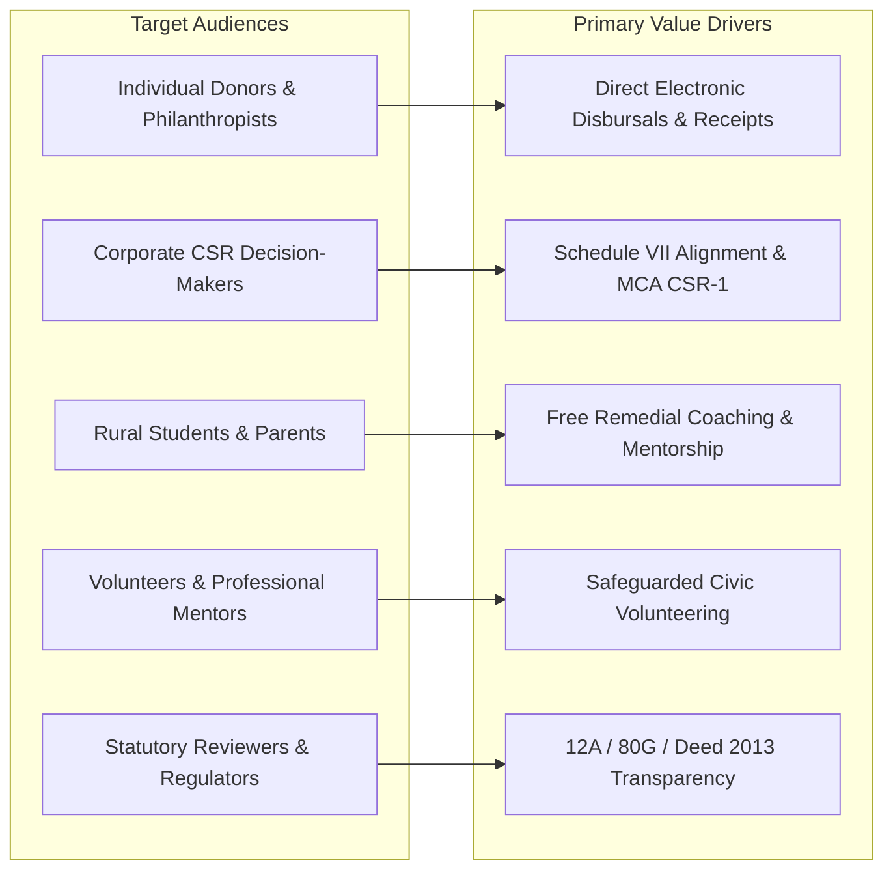

# MECT — BRAND POSITIONING, DIFFERENTIATION & VALUE PROPOSITION FRAMEWORK

**Organisation:** Mahaveer Educational & Charitable Trust (MECT / MAHAVIR TRUST)  
**Corporate & Registered Identity:** Registered Irrevocable Public Charitable Trust (Balangir, Odisha, Estd. 2013)  
**Production Domain:** https://mect.org.in/  
**Document Classification:** Authoritative Strategic Brand Positioning Specification  
**Effective Date:** 2026-11-18  

---

## 1. The Core Institutional Story

```
┌─────────────────────────────────────────────────────────────────────────────┐
│                          THE CENTRAL MECT BRAND THESIS                      │
│                                                                             │
│  "Meaningful community progress in Western Odisha requires an integrated    │
│   safety net, locally rooted execution, and unbending fiduciary transparency│
│   — where every rupee deployed is directly verifiable, and no child or      │
│   family is reduced to a promotional marketing statistic."                  │
└─────────────────────────────────────────────────────────────────────────────┘
```

### 1.1 The WHY (Institutional Purpose)
Why does MECT exist?
- **The Regional Reality:** In Western Odisha—particularly across agrarian, forest, and semi-urban catchment clusters in Balangir district—rural communities face compounding structural vulnerabilities:
  1. *Scholastic Discontinuity:* High drop-out rates during the critical transition between upper-primary and higher-secondary education (Classes 8–10 and +2 Higher Secondary) driven by daily-wage household distress.
  2. *Livelihood Informality:* Limited non-agricultural vocational opportunities for rural women, trapping families in debt cycles.
  3. *Climate & Summer Distress:* Severe seasonal heatwaves (temperatures frequently exceeding 42°C–45°C), creating acute dehydration risks for hospital attendees, daily-wage laborers, and rural transit passengers.
  4. *Seasonal Nutrition & Cold-Wave Shocks:* Winter cold waves affecting vulnerable elderly and daily-wage families lacking adequate warm shelter or seasonal protection.
- **Why This Work Matters:** Philanthropic efforts often fail when they address symptoms in isolation. Providing a student with tuition assistance does not prevent school dropouts if the family lacks clean drinking water during heatwaves or if seasonal debt forces early migration. MECT was founded under its 2013 Trust Deed to build an interconnected, grassroots community safety net.

### 1.2 The WHAT (Five Connected Programme Pillars)
MECT addresses these interlinked challenges through five documented areas of community intervention:
1. **Education & Learning Support (Shiksha Setu):** Remedial after-school coaching circles, board exam mentoring, and textbook support across Balangir and Puintala to prevent academic dropout.
2. **Women Empowerment & Livelihoods (Swavalamban):** Practical vocational tailoring, garment pattern cutting, and craft fabrication training equipping rural women with skills and tooling for home-based micro-enterprises.
3. **Safe Water & Community Wellbeing (Jal Seva):** Purified drinking water points and traditional earthen matka kiosks deployed along transit corridors and public hospital perimeters during peak heatwave cycles.
4. **Food Security & Nutrition Relief (Jan Ahar):** Immediate cooked meals, dry nutrition rations, and emergency sustenance for distress-affected communities during regional weather shocks.
5. **Community Welfare & Civic Rights:** Winter warm-clothing distributions, disaster emergency aid, and grassroots legal/welfare entitlement guidance helping families access statutory government schemes.

### 1.3 The HOW (Operating Methodology)
How does MECT operate differently from typical intermediary charities?
1. **Direct Field Identification:** Needs are identified through continuous on-ground presence in Balangir rather than third-party consultancy surveys.
2. **Board Sanction & Project Segregation:** Every initiative is approved by the honorary Board of Trustees. Dedicated projects (such as the proposed 80–100 ft Hanuman Murti monument) operate under strictly segregated project sub-ledgers (`HANUMAN_MURTI`) with zero general fund commingling.
3. **Direct Electronic Disbursals:** 100% of educational fee assistance is remitted directly to accredited college/school bursar bank accounts via RTGS/NEFT. **Zero cash distributions to individuals.**
4. **Independent Audit & Public Disclosure:** Physical attendance registers, photographic field archives, and annual statutory balance sheets (Form 10B) are maintained and published openly on the website.

### 1.4 The DIFFERENCE (Defensible Differentiation Strategy)
Why should an individual donor, CSR committee, or volunteer choose MECT over other organisations?

| Differentiation Vector | Typical Generic NGO | Mahaveer Educational & Charitable Trust (MECT) |
|---|---|---|
| **Geographic Focus** | Dispersed, short-term project interventions across multiple regions. | **Deep, long-term geographic roots in Western Odisha (Balangir)** with 13+ years of continuous community trust since 2013. |
| **Problem Architecture** | Single-issue silos (only schools or only water) unable to address compounding shocks. | **Integrated 5-pillar safety net** connecting education continuity with maternal livelihoods, heatwave water points, and seasonal welfare. |
| **Financial Execution** | Cash handovers, intermediary agency deductions, high administrative overhead. | **100% direct electronic institution transfers**; zero cash distributions; honorary fiduciary trustee code with zero executive profit extraction. |
| **Metric Integrity** | Inflated claims of "millions of lives changed" based on passive website impressions. | **Audited operational definitions:** strictly reports recorded participation entries (350+ entries, 120+ course enrolments, 10,000+ relief instances), never conflating entries with unique individuals. |
| **Initiative Transparency** | Blurring funded work with prospective ambitions to manufacture false momentum. | **Rigorous status labeling:** active programmes are strictly separated from proposed targets (e.g. proposed 200-student higher education target, proposed 80–100 ft monument). |
| **Media Safeguarding** | Unconsented photos of vulnerable children used as emotional marketing bait. | **Formal Child Safeguarding Charter (`DOC-POL-SAFEGUARDING-2024`):** zero unconsented minors, mandatory parental releases, 7-stage media review lifecycle. |

---

## 2. Institutional Brand Positioning Framework

### 2.1 Institutional Purpose Statement
> *"To eliminate structural barriers to dignity, education, and health across Western Odisha through accountable, multi-sector community development grounded in fiduciary integrity and documented truth."*

### 2.2 Brand Promise
> *"Every programme is documented. Every rupee is electronically traceable. Every initiative is grounded in real community needs."*

### 2.3 Primary Value Proposition
- **For Donors:** A direct, accountable channel where 100% of educational sponsorships transfer directly to accredited college bursars, backed by SHA-256 tamper-evident receipts and audited annual reports.
- **For Corporate CSR Partners:** An established Schedule VII compliant partner with verified MCA registration (`CSR00081063`), transparent project sub-ledger segregation, and robust local operational capacity in Western Odisha.
- **For Rural Students & Families:** Accessible, non-commercial scholastic reinforcement and vocational training designed to preserve academic continuity and family self-reliance.
- **For Volunteers & Mentors:** A dignified, safeguarded platform to contribute teaching, technical skills, and mentorship directly to rural learners.

---

## 3. Core Audience Segments & Engagement Journeys



---

## 4. Emotional vs. Practical Messaging Balance

- **The Emotional Message:** *"Human dignity begins with reliable community support. When an adolescent student in Balangir remains in school instead of dropping out to work, or when a mother gains self-reliant income from vocational tailoring, an entire family's future changes direction."*
- **The Practical Message:** *"MECT is an irrevocable public charitable trust registered in 2013 (Deed Doc No. 40311302194). We maintain strict project sub-ledgers, remit educational grants directly to institution accounts, enforce child safeguarding policies, and publish audited financial statements."*

---

## 5. Explicit Messaging Restrictions (What Must NEVER Be Claimed)

To safeguard MECT's institutional credibility and legal standing, the following guidelines are mandatory across all communication channels:
1. **Never use superlative or unverified claims:** Prohibit *"India's best NGO"*, *"Odisha's leading charity"*, *"unmatched impact"*, *"100% success rate"*, or *"largest grassroots movement"*.
2. **Never misrepresent service entries as unique beneficiaries:** Maintain the clear distinction between 350+ student participation entries, 120+ vocational course enrolments, and 10,000+ relief service instances.
3. **Never represent proposed initiatives as completed or funded:** The proposed higher education target for up to 200 students and the proposed 80–100 ft Hanuman Murti monument must remain explicitly designated as *Proposed*.
4. **Never make unconfirmed tax exemption claims:** State the exact historical Section 80G validity period (`2021-22 to 2025-26`) and maintain a neutral position for FY 2026–27 (`under Chartered Accountant confirmation`) until formal renewal orders are on record.
5. **Never publish unconsented imagery of minors:** Any photograph depicting children must possess a verified guardian consent record under `DOC-POL-SAFEGUARDING-2024`.
