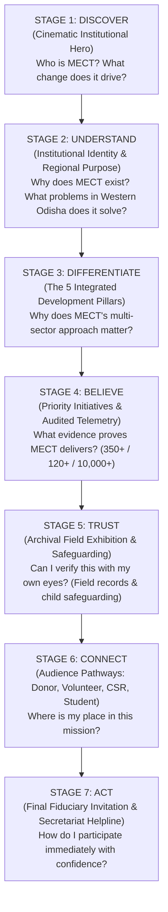

# MECT — BRAND TRANSFORMATION INITIAL FORENSIC AUDIT & BASELINE SPECIFICATION

**Organisation:** Mahaveer Educational & Charitable Trust (MECT / MAHAVIR TRUST)  
**Production Domain (Untouched):** https://mect.org.in/  
**Repository Working Branch:** `feat/brand-storytelling-transformation`  
**Baseline Git Commit:** `528cd12` (*feat(phase-23): master digital transformation with 3d experience, motion system, 7-section homepage and architecture cleanup*)  
**Audit Date:** 2026-11-18  
**Scope:** Brand positioning, value proposition, narrative cohesion, visitor journey psychology, visual differentiation, evidence architecture, motion & 3D capabilities, and protected systems.

---

## 1. Executive Summary & Forensic Narrative Findings

While the recent Phase 23 technical consolidation successfully streamlined the homepage to 7 sections, purged 112.5 KB of dead legacy components, and introduced 3D WebGL experiences, the website's **brand storytelling and institutional differentiation** must now be elevated to communicate an incontrovertible reason for engagement:

1. **The Differentiation Challenge:**
   - Most Indian NGOs rely on broad, interchangeable assertions: *"We empower the underprivileged"*, *"We transform lives"*, *"We bring hope"*.
   - MECT's existing copy, while factual and compliant, occasionally assumes the visitor already appreciates *why* its multi-sector approach in Western Odisha is uniquely structured.
   - The website must clearly articulate **why MECT exists**, **what specific socio-geographic obstacles it tackles in Balangir and Western Odisha**, and **why an integrated approach (Education + Livelihoods + Water + Nutrition + Welfare) succeeds where single-issue interventions stall**.
2. **The Visitor Journey Alignment:**
   - The visitor must experience an intentional psychological progression:
     $$\text{DISCOVER} \longrightarrow \text{UNDERSTAND} \longrightarrow \text{DIFFERENTIATE} \longrightarrow \text{BELIEVE} \longrightarrow \text{TRUST} \longrightarrow \text{CONNECT} \longrightarrow \text{ACT}$$
   - Every homepage section must answer a specific cognitive inquiry in this sequence, eliminating cognitive friction and guiding the visitor to appropriate engagement.
3. **Audience-Specific Conversion Pathways:**
   - Different visitor types arrive with completely distinct evaluation criteria:
     - **Donors:** Seek fiduciary transparency, direct college tuition disbursals (no cash distributions), and automated 80G receipts.
     - **Students / Parents:** Seek clear eligibility criteria, non-commercial admissions guidance, and textbook assistance.
     - **Volunteers:** Seek structured mentorship frameworks, child safeguarding codes, and clear time commitments.
     - **CSR Decision-Makers:** Seek Schedule VII alignment, MCA registration (`CSR00081063`), and audited project segregation.
     - **Statutory Reviewers:** Seek the 2013 registered Trust Deed, Form 10AC/10B filings, and NITI Aayog Darpan credentials.
4. **Authenticity & Integrity Safeguards:**
   - All factual distinctions remain strictly preserved:
     - **350+ recorded student participation entries** (FY 2023–24).
     - **120+ cumulative vocational course enrolments** (FY 2021–23).
     - **10,000+ recorded water and relief service instances**.
     - Proposed higher education target for up to 200 students is strictly labeled *Proposed*.
     - 80–100 ft Hanuman Murti monument is strictly labeled *Proposed Conceptual Initiative* with segregated project sub-ledger (`HANUMAN_MURTI`).
     - Neutral tax position (`unconfirmed` for FY 2026–27) remains in effect.

---

## 2. Forensic Assessment of Current Brand Messaging

| Dimension | Current Implementation Baseline | Brand Transformation Requirement |
|---|---|---|
| **The "Why" (Institutional Purpose)** | Stated in terms of trust deed execution (Balangir 2013). | Elevated to articulate the structural challenges of Western Odisha: regional educational dropouts, extreme seasonal heatwaves, lack of rural vocational training. |
| **The "What" (Five Core Pillars)** | Listed clearly as 5 distinct cards with icons. | Interconnected as an integrated grassroots safety net where each intervention reinforces community resilience. |
| **The "How" (Methodology)** | Located in secondary operational notes. | Prominently demonstrated: field need identification, board governance sanction, direct non-cash electronic execution, and public audit publication. |
| **The "Difference" (Differentiation)** | Demonstrated via statutory badges and absence of middle-agent deductions. | Explicitly highlighted: local community roots, multi-sector integration, 100% direct-to-institution bank disbursals, zero cash handling, and complete documentation transparency. |
| **The Evidence (Belief)** | Verified telemetry numbers (350+, 120+, 10,000+). | Telemetry paired with authentic documentary field photography, accession IDs, and verifiable annual reports. |
| **The Pathways (Connection)** | Basic links to donate, volunteer, CSR. | Tailored audience modules addressing the specific needs of donors, students, volunteers, and corporate partners. |

---

## 3. Visitor Journey Mapping (Homepage 7-Section Architecture)

---

## 4. Technical, Motion & 3D Baseline Inventory

- **Tech Stack:** Next.js 16.4.6 (App Router, Standalone), React 19.3.0, Tailwind CSS v4, `motion` v12.4.7 (`motion/react`), `animejs` v4.5.0, Radix UI primitives.
- **Motion System:** Single canonical token registry in `src/components/ui/MotionPrimitives.tsx` (`MOTION_EASING.institutional`, `MOTION_DURATION`, `MOTION_STAGGER`). Zero CLS, transform/opacity only, 100% `useReducedMotion()` compliant.
- **3D Experiences:**
  - `src/components/campaigns/HanumanMurti3DExperience.tsx`: WebGL/Canvas 3D interactive monument with 360° orbit inspection, specular golden illumination, 80–100 FT dimension indicator, and static fallback.
  - `src/components/charts/OdishaImpactSphere3D.tsx`: Interactive 3D geographical reach sphere mapping Western Odisha hubs with real-time telemetry.
- **Visual Assets:** 70 verified screenshots captured in `reports/phase-23-premium-transformation/`.
- **Protected Systems:** Cashfree payment checkout (`/api/donations/create-order`), HMAC webhook validation, SHA-256 PDF receipt hashing, Donor Portal OTP login, Admin RBAC.

---

## 5. Execution Roadmap & Phase Structure

1. **Phase 1:** Define MECT's Positioning and Unique Value Proposition (`MECT_BRAND_POSITIONING_AND_DIFFERENTIATION.md`).
2. **Phase 2:** Homepage Storytelling Architecture & Conversion Blueprint (`MECT_HOMEPAGE_STORY_AND_CONVERSION_BLUEPRINT.md`).
3. **Phase 3:** Design for Different Visitor Types (Tailored journeys for Donors, Volunteers, CSR, Students, Reviewers).
4. **Phase 4:** Premium Visual Identity & Editorial Typography Execution.
5. **Phase 5:** Modern Animations & Motion Storytelling System (`MECT_MOTION_STORYTELLING_SYSTEM.md`).
6. **Phase 6:** Meaningful 3D Experience Integration (`MECT_3D_EXPERIENCE_AND_ASSET_REPORT.md`).
7. **Phase 7:** High-Quality Photography & Visual Storytelling (`MECT_IMAGE_QUALITY_AND_PROVENANCE_AUDIT.md`).
8. **Phase 8:** Information Architecture & Duplicate Cleanup (`MECT_INFORMATION_ARCHITECTURE_AND_DUPLICATE_CLEANUP_REPORT.md`).
9. **Phases 9–12:** Core Interventions, Evidence Integrity, Inner Pages, and System Preservation.
10. **Phases 13–15:** Continuous Implementation Loop, Quality Gates, Visual Capture in `reports/mect-brand-transformation/`, and Final Review (`MECT_FINAL_VISUAL_AND_TECHNICAL_REVIEW.md`).
11. **Phase 16:** Absolute Production Deployment Freeze Enforcement.
