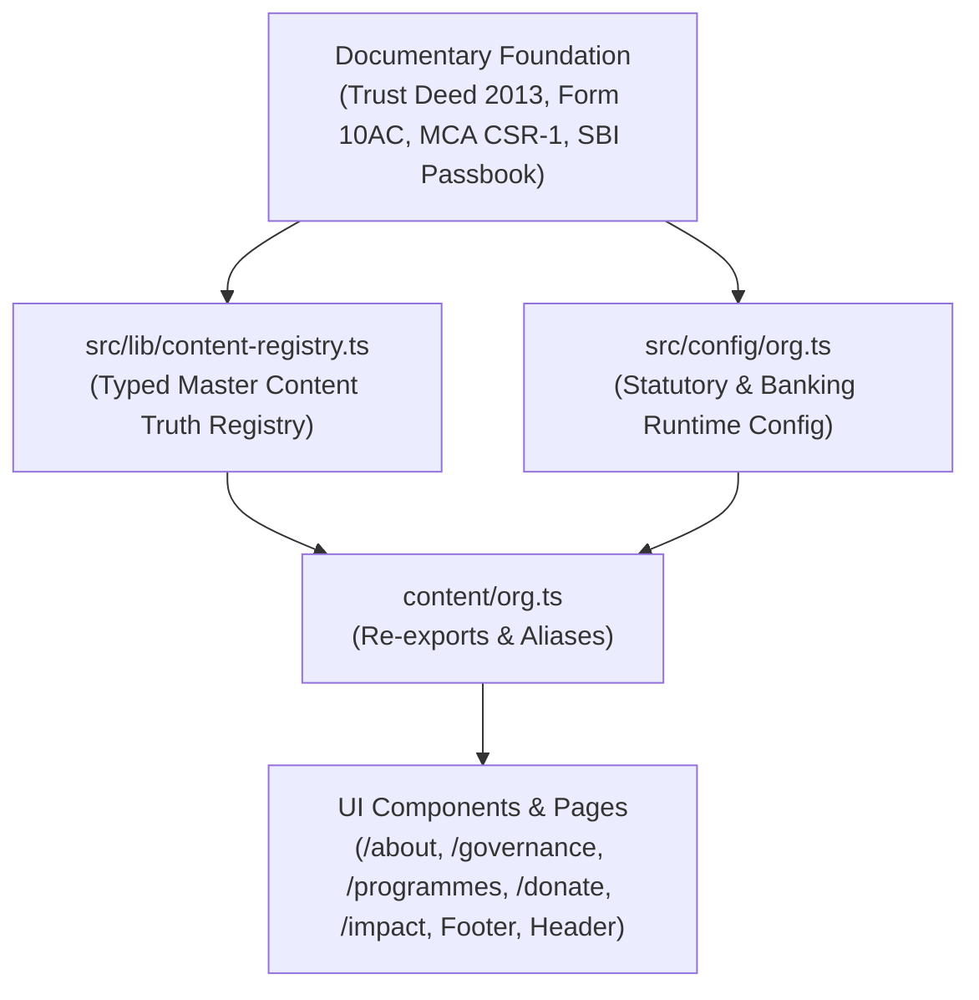

# MECT — GOVERNED CONTENT ARCHITECTURE
**Canonical Source of Truth Specification (Phase 2)**

- **Project:** Mahaveer Educational & Charitable Trust (MECT)
- **Domain:** `https://mect.org.in/`
- **Specification Document:** `docs/audits/MECT_CONTENT_ARCHITECTURE.md`
- **Active Branch:** `feat/complete-website-redefinition-and-deduplication`
- **Auditor:** Antigravity Principal Architecture & Content Director
- **Effective Date:** 2026-11-24

---

## 1. Single Source of Truth Hierarchy

To eliminate the 4 levels of duplicate content identified in Phase 1, all application components, pages, and metadata must consume facts strictly from designated single sources of truth. Hardcoded literals in JSX are prohibited.

---

## 2. Governed Truth Domains & Canonical Targets

### 2.1 Organisation Identity & Legal Form
- **Canonical Source:** `MECT_CONTENT_REGISTRY.identity` (`src/lib/content-registry.ts`) & `MECT_ORG` (`src/config/org.ts`)
- **Official Registered Name:** `MAHAVEER EDUCATIONAL & CHARITABLE TRUST`
- **Public Display Name:** `Mahaveer Educational & Charitable Trust (MECT)`
- **Abbreviation:** `MECT`
- **Legal Form:** `Irrevocable Public Charitable Trust`
- **Governing Law:** `Indian Trusts Act, 1882`
- **Trust Deed Execution Date:** `27th July 2013`
- **Trust Deed Registration Date:** `30th July 2013`
- **Registration Authority:** `District Sub-Registrar, Balangir, Government of Odisha`
- **Deed Reference:** `Book No. 4, Volume No. 45, Document Deed No. 40311302194`
- **Motto:** `Knowledge, Compassion & Self-Reliance Across Odisha`
- **Tagline:** `Empowering Futures Through Education, Rural Skilling & Fiduciary Philanthropy`

### 2.2 Board of Trustees & Governance
- **Canonical Source:** `MECT_CONTENT_REGISTRY.governance` & `content/trustees.ts`
- **Settler Founder & Chairman cum Managing Trustee:** **Er. Japabandhu Kampa** (Deed Clauses 8(2), 10, XVI)
- **Honorary Service Guarantee:**
  > *"All trustees serve in an honorary capacity without salary, fee, or personal remuneration under registered Trust Deed Clause XVI."*
- **Board Composition:** 3 to 9 Honorary Trustees per Deed Clause 8(1).

### 2.3 Statutory Registrations & Regulatory Compliance
- **Canonical Source:** `MECT_CONTENT_REGISTRY.statutoryCredentials`
- **Permanent Account Number (PAN):** `AADTM5474F`
- **Section 12A URN:** `AADTM5474FE20231` (Order date: `29-01-2024`, validity: AY 2024-25 to AY 2026-27)
- **Section 80G URN:** `AADTM5474FF20241` (Order date: `29-01-2024`, validity: AY 2024-25 to AY 2026-27)
- **MCA CSR-1 Registration:** `CSR00081063` (SRN: `N14617237`, approval date: `09-11-2024`)
- **NITI Aayog NGO Darpan:** `OR/2024/0466491`
- **MoSJE e-Anudaan:** `OR/00040466`
- **Mandatory Tax Wording:**
  > *"Tax treatment of contributions is subject to applicable law and confirmation of the Trust's current statutory eligibility."*

### 2.4 Official Banking Coordinates (State Bank of India)
- **Canonical Source:** `MECT_ORG.bank` & `MECT_CONTENT_REGISTRY.banking`
- **Bank Name:** `State Bank of India`
- **Account Holder:** `MAHAVEER EDUCATIONAL & CHARITABLE TRUST`
- **Account Number:** `33341302498`
- **IFSC Code:** `SBIN0001701`
- **Branch:** `Rajendra College Square, Bolangir, Odisha`
- **Account Type:** `Current Account`
- **Primary UPI VPA:** `86971610172@sbi` (Secondary: `9853608113@sbi`)

### 2.5 Contact Desks & Office Coordinates
- **Canonical Source:** `MECT_ORG.contact`, `MECT_ORG.addresses`, `MECT_CONTENT_REGISTRY.offices`
- **Registered Office:** `Near Sai Mandir, Rugudipara, Balangir, Odisha - 767001`
- **Corporate Liaison Secretariat:** `A1, 3rd Floor, Lewis Plaza, BJB Nagar, Bhubaneswar, Odisha - 751014`
- **Helpline Phone:** `+91 94371 23616` (Primary) / `+91 98536 08113` (Secretariat)
- **Official Email:** `mect220@gmail.com`
- **Office Hours:** `Mon–Sat, 10:00–17:30 IST`

### 2.6 Programme Catalogue
- **Canonical Source:** `MECT_CONTENT_REGISTRY.programmes`
- **Active Operational Programmes:**
  1. *Remedial Rural Education (Shiksha Setu)* — Balangir & Puintala Blocks
  2. *Women's Vocational Tailoring School (Swavalamban)* — Rugudipara & Chandrasekhar Nagar
  3. *Jal Seva Heatwave Potable Drinking Water Relief* — District-wide seasonal relief
  4. *Jan Ahar Hospital Patient Attendant Food Relief* — District Headquarters Hospital Balangir
- **Historical Completed Drives:**
  1. *COVID-19 Pandemic Emergency Ration Relief* (2020–2021)
  2. *Monsoon & Cyclone Emergency Sustenance*
- **Proposed Pipeline Initiatives (Explicitly Flagged):**
  1. *Project Samarth: Community Digital Learning Centers*
  2. *Endowed Higher Education Tuition Grant Fund* (Target: Up to 200 Students)
  3. *Rural Mobile Health & Eye Screening Van*

### 2.7 Campaign Catalogue
- **Canonical Source:** `src/app/campaigns/page.tsx` & `src/lib/routes.ts`
- **Featured Cultural Heritage Campaign:** *The Grand Hanuman Murti Project* (Proposed 80–100 ft monument at Puintala, Balangir; currently at architectural feasibility & 3D planning phase).
- **Featured Educational Campaign:** *Free Higher Education Grants (Target: Up to 200 Students)*.

### 2.8 Fiduciary Standards & Disbursal Policy
- **Canonical Source:** `MECT_CONTENT_REGISTRY.fiduciaryStandards`
- **100% Direct Disbursal:** All student tuition grants are paid directly to the accredited college or university via institutional RTGS/NEFT. Zero cash is handled.
- **Zero Intermediary Policy:** No educational brokers, consultants, or commercial agents are engaged.
- **₹0 Free Applications:** All scholarship and volunteer applications are 100% free of charge.

---

## 3. Implementation Guardrails

1. Any JSX component displaying legal numbers (PAN, 12A, 80G, CSR-1, Darpan, Deed) must import them from `MECT_CONTENT_REGISTRY` or `ORG`.
2. Any component displaying bank details or QR codes must read from `MECT_ORG.bank` or `MECT_CONTENT_REGISTRY.banking`.
3. No component may make unverified statutory tax claims ("100% Tax Free", "Instant 10BE").
4. Discrepancies between source documents must be documented in `docs/audits/OWNER_DECISIONS.md`.
