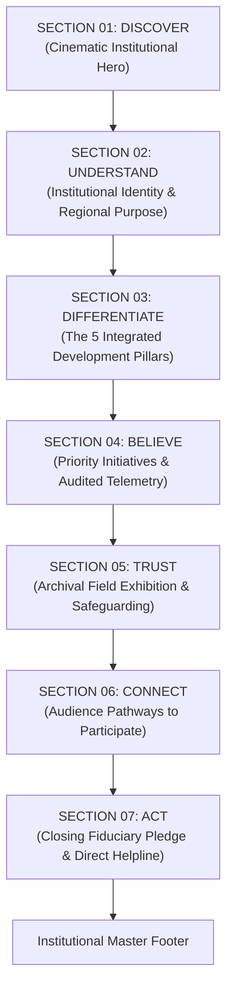

# MECT — HOMEPAGE STORYTELLING & CONVERSION BLUEPRINT

**Organisation:** Mahaveer Educational & Charitable Trust (MECT / MAHAVIR TRUST)  
**Document Purpose:** Architectural Specification for 7-Section Homepage Narrative & Conversion Flow  
**Target Visitor Psychological Flow:**  
$$\text{DISCOVER} \longrightarrow \text{UNDERSTAND} \longrightarrow \text{DIFFERENTIATE} \longrightarrow \text{BELIEVE} \longrightarrow \text{TRUST} \longrightarrow \text{CONNECT} \longrightarrow \text{ACT}$$
**Effective Date:** 2026-11-18  

---

## 1. The 7-Section Homepage Master Blueprint

---

## 2. Comprehensive Section-by-Section Narrative Specification

### SECTION 01 — DISCOVER: The Cinematic Institutional Hero
- **The Visitor's Question:** *"Who is this organisation, what do they stand for, and why should I care within the first 5 seconds?"*
- **Main Headline:** *"Fostering Dignity, Opportunity & Resilience Across Western Odisha"*
- **Supporting Narrative (35–45 words):**  
  *"Mahaveer Educational & Charitable Trust (MECT) is a registered public charitable trust dedicated to bridging educational dropout gaps, building women's livelihood self-reliance, and delivering seasonal climate relief in rural communities."*
- **Evidence Displayed:** Dynamic telemetry badge: *"13+ Years Continuous Community Trust • 10,000+ Relief Instances • 100% Direct Disbursals"*.
- **Visual Composition:** Full-bleed cinematic hero canvas in Warm Cream with Forest Green typography, subtle Terracotta accents, high contrast, and zero layout shift.
- **Image Requirement:** High-resolution campus walk photograph with founding trustees (`mect-trustees-campus-walk.webp`, WebP, pre-loaded with `priority={true}`).
- **Motion Behaviour:** Instant server render (`opacity: 1`), gentle text reveal with `MOTION_EASING.editorial` (580ms), zero CLS.
- **Calls to Action:**
  - Primary CTA: `Explore Our Work` (Smooth scroll to `#work-areas`)
  - Secondary CTA: `Support a Programme` (Links to `/donate`)
- **Narrative Transition:** *"To understand why our work matters, understand the community challenges of Western Odisha..."* (leads directly into Section 02).

---

### SECTION 02 — UNDERSTAND: Institutional Identity & Regional Purpose
- **The Visitor's Question:** *"Why does MECT exist, what specific problems in Western Odisha is it solving, and is this a real registered entity?"*
- **Main Heading:** *"Locally Grounded Community Stewardship Since 2013"*
- **Supporting Narrative (60–75 words):**  
  *"Founded under a registered public Trust Deed in Balangir (July 2013), MECT was established by local educators, social advocates, and civic leaders to address chronic structural challenges in Western Odisha. Rather than relying on distant intermediaries, we operate directly on the ground—supporting rural first-generation learners, training women in marketable crafts, and maintaining emergency drinking water stations during extreme 42°C+ summer heatwaves."*
- **Evidence Displayed:** 4 Statutory Badges with verifiable filing identifiers:
  1. *Deed of Trust 2013 (Balangir Sub-Registrar, Doc No. 40311302194)*
  2. *Section 12A Registration (Historical URN: AABTM0244JE20211)*
  3. *Section 80G Approval (Historical URN: AABTM0244JF20211)*
  4. *MCA CSR-1 Registration (CSR00081063 for Schedule VII Corporate Engagements)*
- **Visual Composition:** Asymmetrical 2-column editorial card: left side features authentic campus trustees walk photography; right side presents the institutional charter and verified credentials.
- **Motion Behaviour:** Scroll-triggered viewport entrance (`whileInView`, `distance: 14px`, `MOTION_EASING.institutional`).
- **Calls to Action:**
  - Primary CTA: `Read Full Institutional History` (Links to `/about`)
  - Secondary CTA: `Review Governance Charter` (Links to `/governance`)
- **Narrative Transition:** *"Our response to these community challenges is structured across five connected areas of work..."* (leads into Section 03).

---

### SECTION 03 — DIFFERENTIATE: The Five Integrated Development Pillars
- **The Visitor's Question:** *"What makes MECT's approach different from every other charity that claims to help the poor?"*
- **Main Heading:** *"An Integrated Safety Net Across Five Development Focus Areas"*
- **Supporting Narrative (45–55 words):**  
  *"Single-issue charities often fail when poverty is multi-dimensional. A child cannot stay in school if seasonal heatwaves cut off family water supplies or if a mother lacks livelihood independence. MECT connects educational continuity directly with maternal vocational training and seasonal emergency relief."*
- **The 5 Work Areas:**
  1. *Education & Learning Support:* After-school remedial hubs preventing dropout in Classes 8–10.
  2. *Women Empowerment & Livelihoods:* Certified tailoring and craft fabrication for home micro-enterprises.
  3. *Safe Water & Community Wellbeing:* Purified Jal Seva water points during 42°C+ summer heatwaves.
  4. *Food Security & Nutrition Relief:* Emergency dry rations and hot meal assistance during regional distress.
  5. *Community Welfare & Civic Rights:* Seasonal winter clothing distribution and rural welfare entitlement awareness.
- **Visual Composition:** 5-card responsive grid with distinct iconography, individual accent styling, and hover elevation micro-interactions.
- **Motion Behaviour:** `StaggerGroup` with 55ms staggered card appearances; transform/opacity only.
- **Calls to Action:** `Explore Full Programme Details` (Links to `/programmes`).
- **Narrative Transition:** *"How does this integrated approach translate into strategic initiatives and verifiable evidence?..."* (leads into Section 04).

---

### SECTION 04 — BELIEVE: Priority Initiatives & Audited Telemetry (Consolidated)
- **The Visitor's Question:** *"What proof exists that MECT actually delivers, and what major initiatives is it currently advancing?"*
- **Main Heading:** *"Strategic Initiatives & Documented Grassroots Evidence"*
- **Supporting Narrative:** Combines prospective institutional initiatives with verified field operational telemetry.
- **Part A: Priority Initiatives (Side-by-Side):**
  1. *Higher Education Support Target (Up to 200 Students):*
     - Clear Status Tag: `Proposed Target • Subject to Board Sanction`
     - Disclosure: *Confirmed funded places currently stand at zero. Direct electronic college tuition transfers via RTGS; zero cash distributions.*
     - CTA: `Review Scholarship Scheme Criteria` (Links to `/scholarships`)
  2. *The Grand Hanuman Murti Project (80–100 Ft Monument):*
     - Clear Status Tag: `Proposed Monument • Conceptual 3D Preview`
     - Disclosure: *Conceptual architectural vision celebrating Lord Hanuman as the emblem of selfless service (Seva). Contributions held in strictly segregated project sub-ledger (`HANUMAN_MURTI`) with zero general fund commingling.*
     - Interactive 3D Component: Embedded `HanumanMurti3DExperience` allowing 360° orbital tilt with live 80–100 FT dimension indicator.
     - CTA: `Explore Project Roadmap` (Links to `/campaigns/hanuman-murti`)
- **Part B: Audited Telemetry Bar (Dark High-Contrast Band):**
  - Metric 1: **350+** Student Participation Entries (FY 2023–24 Balangir Remedial Hubs)
  - Metric 2: **120+** Vocational Course Enrolments (FY 2021–23 Tailoring Multi-Cohort Cycles)
  - Metric 3: **10,000+** Water & Relief Service Instances (Seasonal Jal Seva Kiosks)
  - Metric 4: **13+ Years** Continuous Registered Trust Operations (2013–Present)
- **Calls to Action:** `Inspect Full Methodology & Audit Reports` (Links to `/impact`).
- **Narrative Transition:** *"Do not just take our figures on paper. Inspect our archival field records and photographic documentation..."* (leads into Section 05).

---

### SECTION 05 — TRUST: Archival Memories & Documentary Exhibition
- **The Visitor's Question:** *"Can I verify this work with my own eyes, and are the people in these photographs treated with dignity?"*
- **Main Heading:** *"Archival Memories — Documenting Field Operations"*
- **Supporting Narrative (40–50 words):**  
  *"Every photograph in the MECT archive represents authentic on-ground operations across Western Odisha. In strict adherence to our Institutional Child Safeguarding Policy (`DOC-POL-SAFEGUARDING-2024`), all images follow verified participant consent charters and zero staged PR scenes."*
- **Visual Composition:** Asymmetrical editorial gallery layout previewing 5 authentic field photographs:
  - Lead feature: Balangir Remedial Coaching Circle
  - Secondary grid: Women's vocational tailoring, Jal Seva water kiosk, community legal literacy session.
  - Interactive Feature: Accessible Lightbox Modal allowing full-screen inspection with accession numbers and provenance metadata.
- **Evidence Displayed:** Child Safeguarding Badge (`DOC-POL-SAFEGUARDING-2024`) and 7-stage media review lifecycle confirmation.
- **Calls to Action:** `Explore Full Archival Gallery & Field Dispatches` (Links to `/memories-gallery`).
- **Narrative Transition:** *"Now that you understand our mission and verified evidence, where is your place in this work?..."* (leads into Section 06).

---

### SECTION 06 — CONNECT: Tailored Audience Pathways
- **The Visitor's Question:** *"I am interested, but how does someone like me specifically engage with MECT?"*
- **Main Heading:** *"Pathways to Participate — Find Your Place in Our Mission"*
- **Four Tailored Journey Modules:**
  1. *For Donors & Sponsors:* Direct electronic contributions, dedicated project ledgers, instant SHA-256 PDF receipts, and historical 80G tax clarity. (Links to `/donate`)
  2. *For Supporters & Active Donors:* Secure OTP-authenticated portal to download annual tax summaries, track pledge histories, and update consent settings. (Links to `/portal/login`)
  3. *For Volunteers & Mentors:* Opportunities to teach secondary students, lead vocational training, or assist emergency water relief under safeguarding codes. (Links to `/volunteer`)
  4. *For Corporate CSR Committees:* Schedule VII aligned development partnerships supported by MCA registration (`CSR00081063`) and independent audit oversight. (Links to `/csr-partnerships`)
- **Visual Composition:** 4 elevated cards with distinct role indicators, clear action verbs, and badge tags.
- **Calls to Action:** Direct button on each respective card.
- **Narrative Transition:** *"Join hands with a registered, accountable public institution..."* (leads into Section 07).

---

### SECTION 07 — ACT: Final Fiduciary Invitation
- **The Visitor's Question:** *"What is the final invitation, where are MECT's offices, and how can I reach leadership directly?"*
- **Main Heading:** *"A Commitment to Fiduciary Integrity & Lasting Community Change"*
- **Supporting Narrative:** Closing institutional pledge reaffirming registered trust status, zero intermediary deductions, and open secretariat access.
- **Contact & Transparency Data Displayed:**
  - Registered Trust Office: Balangir, Western Odisha (PIN 767001)
  - Regional & Liaison Desk: Bhubaneswar, Odisha
  - Direct Secretariat Helpline: `+91 94372 05244` (9:00 AM – 6:00 PM IST)
  - Official Verification Email: `contact@mect.org.in`
- **Visual Composition:** Dignified full-width institutional callout in deep forest green with warm sand typography, official trust seal, and direct telephone/email triggers.
- **Calls to Action:**
  - Primary CTA: `Make a Direct Contribution` (Links to `/donate`)
  - Secondary CTA: `Contact the Secretariat Desk` (Links to `/contact`)
