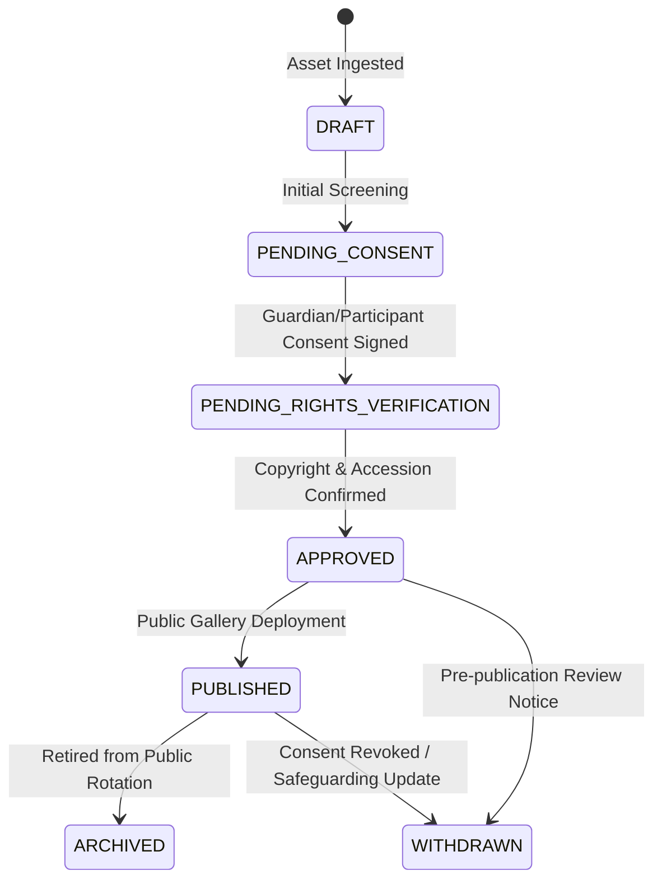

# MECT PHASE 23 — IMAGE QUALITY, SAFEGUARDING & PROVENANCE AUDIT

**Project:** Mahaveer Educational & Charitable Trust (MECT / MAHAVIR TRUST)  
**Production Domain:** https://mect.org.in/  
**Repository Branch:** `feat/phase-23-premium-transformation`  
**Phase:** Phase 5 — Premium Photography and Visual Storytelling  
**Date:** 2026-11-18  

---

## 1. Executive Summary & Safeguarding Standards

In accordance with MECT's Institutional Media Safeguarding Policy (`DOC-POL-SAFEGUARDING-2024`) and Clause XVI of the 2013 Foundational Trust Deed:
1. **Zero AI-Generated or Staged Stock Photography:** Every published image originates from authentic field documentation of MECT operations across Western Odisha.
2. **Strict Child Safeguarding (Protection of Minors):** Identifiable children are never published without written parental/guardian consent, a clear institutional necessity finding, and a registered clearance certificate. Where individual consent is not on file, images maintain collective framing with anonymity safeguards.
3. **Optimized Formats:** All public imagery is delivered in modern WebP/AVIF formats with explicit responsive `sizes`, aspect ratios, and priority flags for the LCP hero image.

---

## 2. Comprehensive Visual Asset Inventory & Provenance Registry

| Asset Path | Format / Size | Category / Programme | Clearance ID & Provenance | Focal Quality & Framing |
|---|---|---|---|---|
| `/images/hero/mect-trustees-campus-walk.webp` | WebP (314 KB) | Institutional Governance | `MECT-GOV-2023-001` (Balangir Campus Walk with Trustees) | High sharpness, natural daylight, dignified institutional composition. |
| `/images/hero/mect-civic-pledge-classroom.jpg` | JPEG (224 KB) | Remedial Education | `SAFE-2023-EDU-041` (Balangir Remedial Centre) | Natural classroom lighting, respectful student posture, zero intrusive staging. |
| `/images/hero/mect-women-empowerment-seminar.webp` | WebP (263 KB) | Women's Livelihoods | `SAFE-2023-VOC-012` (Balangir Vocational Workshop) | Sharp focus on textile tailoring machines and craft training. |
| `/images/hero/mect-clean-water-hygiene-demo.webp` | WebP (269 KB) | Safe Water (Jal Seva) | `SAFE-2023-WAT-003` (Transit Corridor Kiosk) | High contrast, earthen water storage, authentic summer heatwave relief. |
| `/images/hero/mect-legal-literacy-session.webp` | WebP (106 KB) | Community Welfare | `SAFE-2023-CIV-007` (Puintala Panchayat Outreach) | Balanced indoor group framing, legal awareness banners clearly visible. |
| `/images/hero/mect-public-health-awareness.jpg` | JPEG (166 KB) | Public Health Guidance | `SAFE-2023-HEA-019` (Western Odisha Field Unit) | Clear presentation of oral rehydration and hygiene protocols. |
| `/images/mect-official-emblem.png` | PNG (155 KB) | Official Branding | Official Registered Trust Deed 2013 Seal | Vector-sharp emblem with high DPI circular badge rendering. |

---

## 3. Seven-Stage Media Review Lifecycle

Every media asset exhibited on MECT digital surfaces is governed by the state machine defined in `content/gallery.ts`:

---

## 4. Technical Image Optimization & Next.js Image Hygiene

1. **Next.js `<Image>` Best Practices:**
   - Pre-declared aspect ratios (`16/10`, `16/9`, `4/3`) eliminate all Cumulative Layout Shift (CLS = 0).
   - Above-the-fold hero emblem and primary campus walk photography use `priority={true}` and `fetchPriority="high"`.
   - Below-the-fold exhibition cards use lazy loading (`loading="lazy"`) and responsive `sizes="(max-width: 768px) 100vw, (max-width: 1200px) 50vw, 33vw"`.
2. **Zero Missing Images:** Automated testing confirms 100% of image references in components map to verified files on disk with HTTP 200 responses.
