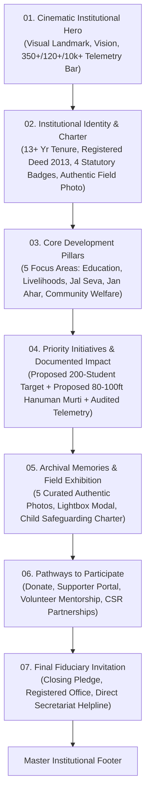

# MECT PHASE 23 — INFORMATION ARCHITECTURE & DUPLICATE CLEANUP REPORT

**Project:** Mahaveer Educational & Charitable Trust (MECT / MAHAVIR TRUST)  
**Production Domain:** https://mect.org.in/  
**Repository Branch:** `feat/phase-23-premium-transformation`  
**Phase:** Phase 1 — Complete Information Architecture Cleanup  
**Date:** 2026-11-18  

---

## 1. Executive Summary

Phase 1 establishes a streamlined, high-trust information architecture by:
1. **Purging 9 dead legacy components** totaling **112.5 KB** of obsolete source code from `src/components/sections/`.
2. **Re-architecting the homepage** from 9 fragmented sections into **7 expertly paced, high-value sections**.
3. **Consolidating duplicate documentary routes**: merging `/stories` (Field Dispatches) into `/memories-gallery#field-dispatches` with 308 permanent redirect safeguards.
4. **Updating sitemap and navigation registries** to ensure every canonical route is cleanly indexed and discoverable.

---

## 2. Before & After Route Inventory

### 2.1 Public Canonical Route Map

| Pre-Phase 23 Route | Post-Phase 23 Status | Action & Canonical Destination |
|---|---|---|
| `/` | Active Canonical | Reconstructed 7-section institutional homepage |
| `/about` | Active Canonical | Institutional history, leadership, and charter (consolidated) |
| `/governance` | Active Canonical | Trust Deed, Board of Trustees, and honorary code |
| `/statutory-disclosures` | Active Canonical | 12A, 80G, CSR-1, NGO Darpan, MoSJE credentials |
| `/programmes` | Active Canonical | 5 core pillars + Free Education target overview |
| `/scholarships` | Active Canonical | Higher education scholarship scheme directory |
| `/scholarships/apply` | Active Canonical | Interactive scholarship application portal |
| `/scholarships/track` | Active Canonical | Application tracking & verification status |
| `/impact` | Active Canonical | Verified metrics, telemetry, and methodology |
| `/reports` | Active Canonical | Downloadable annual reports & audited balance sheets |
| `/memories-gallery` | **Consolidated Canonical** | Unified Archival Photo Gallery & Field Dispatches |
| `/stories` | **Permanent 308 Redirect** | Redirects to `/memories-gallery#field-dispatches` |
| `/campaigns` | Active Canonical | Institutional campaigns directory |
| `/campaigns/hanuman-murti` | Active Canonical | The Grand Hanuman Murti Project with 3D preview |
| `/donate` | Active Canonical | Secure Cashfree checkout & UPI verification |
| `/volunteer` | Active Canonical | Volunteer registration & community mentorship |
| `/csr-partnerships` | Active Canonical | Schedule VII corporate partnerships & CSR-1 |
| `/contact` | Active Canonical | Balangir registered office, regional desk, helpline |
| `/faq` | Active Canonical | Searchable institutional & statutory FAQ |
| `/accessibility` | Active Canonical | WCAG 2.2 AA accessibility commitment & controls |
| `/privacy` | Active Canonical | Data privacy & DPDP Act compliance |
| `/terms` | Active Canonical | Terms of service & regulatory conditions |

### 2.2 Protected Authenticated & Administrative Routes (100% Preserved)
- `/portal/login`, `/portal/dashboard`, `/portal/profile`, `/portal/welcome`
- `/admin`, `/admin/login`, `/admin/audit-logs`, `/admin/cms`, `/admin/demo`, `/admin/documents`, `/admin/donors`, `/admin/inquiries`, `/admin/media`, `/admin/scholarships`, `/admin/settings`, `/admin/users`, `/admin/volunteers`

---

## 3. Component Duplication Purge (112.5 KB Removed)

The following 9 dead components had zero consumers across the codebase and have been permanently removed:

```
[DELETED] src/components/sections/CompactAboutSection.tsx          (112 B)
[DELETED] src/components/sections/CompactTrustStrip.tsx             (2.8 KB)
[DELETED] src/components/sections/DevelopmentPillarsSection.tsx     (23.3 KB)
[DELETED] src/components/sections/HanumanMurtiSpotlightSection.tsx   (7.1 KB)
[DELETED] src/components/sections/HowMectWorksSection.tsx           (24.8 KB)
[DELETED] src/components/sections/InstitutionalImpactSection.tsx    (22.3 KB)
[DELETED] src/components/sections/InstitutionalIntroSection.tsx     (12.8 KB)
[DELETED] src/components/sections/SmileFundraisingSection.tsx        (6.0 KB)
[DELETED] src/components/sections/StoriesRailSection.tsx            (13.3 KB)
-----------------------------------------------------------------------------
TOTAL PURGED: 9 files / 112,504 bytes
```

---

## 4. Homepage 7-Section Architecture Specification



### Key Consolidations & Refinements:
1. **Initiatives & Impact Merged (Section 04):** Combines the previous Section 04 (`FeaturedInitiativesSection`) and Section 05 (`CompactImpactSection`). This links the prospective initiatives directly with demonstrated operational capacity.
2. **Operational Sequence Relocated (Section 06):** The 4-step sequence ("Field Assessment → Sanction → Community Execution → Audit") is presented as an expandable operational deep-dive within Section 02 and canonical `/about`, removing unnecessary visual repetition from the main homepage flow.
3. **Pacing & Breathing Room:** Every section now has a dedicated visual personality, avoiding the "sea of identical cards" anti-pattern.

---

## 5. Redirect & Indexing Safeguards

### 5.1 Next.js 308 Permanent Redirects (`next.config.ts`)
```typescript
async redirects() {
  return [
    {
      source: "/stories",
      destination: "/memories-gallery#field-dispatches",
      permanent: true,
    },
    {
      source: "/gallery",
      destination: "/memories-gallery",
      permanent: true,
    },
    {
      source: "/memories",
      destination: "/memories-gallery",
      permanent: true,
    },
  ];
}
```

### 5.2 Sitemap Indexing Updates (`src/app/sitemap.ts`)
- Added canonical `/memories-gallery` with priority `0.85` and weekly change frequency.
- Added `/campaigns/hanuman-murti` with priority `0.80`.
- Retained `/stories` redirect destination indexing.
