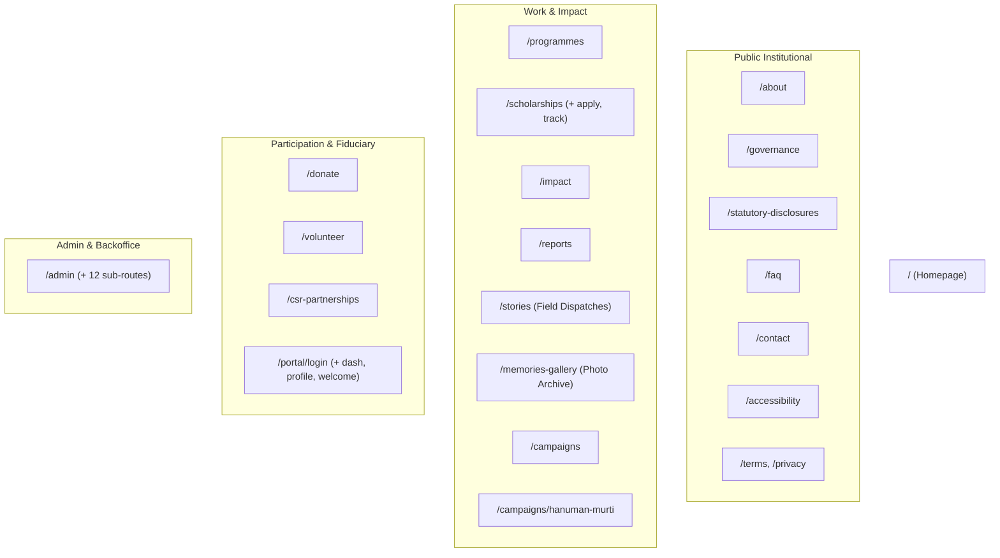

# MECT PHASE 23 — INITIAL FORENSIC AUDIT & TRANSFORMATION BASELINE

**Project:** Mahaveer Educational & Charitable Trust (MECT / MAHAVIR TRUST)  
**Production Website:** https://mect.org.in/  
**Repository:** https://github.com/Himansu-Nayak/MAHAVIR-TRUST  
**Active Working Branch:** `feat/phase-23-premium-transformation`  
**Baseline Git Commit:** `7d173f7` (Phase 22 Visual Review & Owner Feedback Baseline)  
**Date of Forensic Audit:** 2026-11-18  
**Audit Scope:** Codebase architecture, information structure, component redundancy, motion systems, 3D capabilities, visual assets, performance profiles, and functional preservation contracts.

---

## 1. Executive Summary & Forensic Findings

The Phase 22 implementation successfully established a solid factual baseline, child safeguarding policies, and an initial 9-section homepage with verified statutory credentials. However, a deep architectural and code-level forensic audit reveals several critical redundancy, performance, and structural opportunities that must be resolved to achieve the Phase 23 Master Objective:

1. **Section Duplication & Legacy Leftovers:**
   - 9 legacy section components remain in `src/components/sections/` (`CompactAboutSection.tsx`, `CompactTrustStrip.tsx`, `DevelopmentPillarsSection.tsx` [23.3 KB], `HanumanMurtiSpotlightSection.tsx` [7.1 KB], `HowMectWorksSection.tsx` [24.8 KB], `InstitutionalImpactSection.tsx` [22.3 KB], `InstitutionalIntroSection.tsx` [12.8 KB], `SmileFundraisingSection.tsx` [6.0 KB], `StoriesRailSection.tsx` [13.3 KB]). These 9 dead files total **over 110 KB** of unreferenced legacy code.
2. **Competing Animation Libraries & Duplicate Primitives:**
   - Two competing motion abstraction layers exist simultaneously:
     - `src/components/motion/Reveal.tsx` (consuming `src/lib/motion.ts`).
     - `src/components/ui/MotionPrimitives.tsx` (consuming `motion/react` with custom easing/timing tokens).
   - This duplication fragments animation timing across components and bloats bundle size.
3. **Information Architecture Overlap:**
   - The homepage contains 9 sections, creating cognitive fatigue and repetitive calls to action.
   - Separate routes `/stories` (Field Dispatches) and `/memories-gallery` (Archival Photo Gallery) divide documentary evidence into competing channels rather than presenting a unified, powerful narrative archive.
   - `/campaigns` directory lists only 2 initiatives which are already covered on dedicated pages (`/campaigns/hanuman-murti` and `/programmes#free-education`).
4. **3D Experience Absence:**
   - The project currently has zero 3D components. Conceptual initiatives (like the proposed 80–100 ft Hanuman Murti) rely on a static 2D SVG illustration (`HanumanMurtiVisual.tsx`), missing an opportunity for interactive WebGL depth, dynamic lighting, and orbital inspection.
5. **Rigorous Safeguarding & Legal Verification:**
   - All factual distinctions established in Phase 22 (350+ student participation entries, 120+ vocational enrolments, 10,000+ relief service instances; proposed 200-student education targets and 80–100 ft Hanuman Murti strictly labeled *Proposed*; neutral tax status for FY 2026–27) are fully documented and preserved.

---

## 2. Forensic Inventory of Redundancies & Dead Code

### 2.1 Orphaned Legacy Section Components (to be purged/consolidated)

| Component Path | Size | Referenced In | Status & Action |
|---|---|---|---|
| `src/components/sections/CompactAboutSection.tsx` | 112 B | None (Self only) | **DEAD CODE** — Delete |
| `src/components/sections/CompactTrustStrip.tsx` | 2.8 KB | None (Self only) | **DEAD CODE** — Consolidated into `InstitutionalIdentityTrustSection` — Delete |
| `src/components/sections/DevelopmentPillarsSection.tsx` | 23.3 KB | None (Self only) | **DEAD CODE** — Replaced by `CompactWorkAreasSection` — Delete |
| `src/components/sections/HanumanMurtiSpotlightSection.tsx` | 7.1 KB | None (Self only) | **DEAD CODE** — Consolidated into `FeaturedInitiativesSection` — Delete |
| `src/components/sections/HowMectWorksSection.tsx` | 24.8 KB | None (Self only) | **DEAD CODE** — Superseded by `CompactHowMectWorks` — Delete |
| `src/components/sections/InstitutionalImpactSection.tsx` | 22.3 KB | None (Self only) | **DEAD CODE** — Superseded by `CompactImpactSection` — Delete |
| `src/components/sections/InstitutionalIntroSection.tsx` | 12.8 KB | None (Self only) | **DEAD CODE** — Superseded by `InstitutionalIdentityTrustSection` — Delete |
| `src/components/sections/SmileFundraisingSection.tsx` | 6.0 KB | None (Self only) | **DEAD CODE** — Redundant fundraising widget — Delete |
| `src/components/sections/StoriesRailSection.tsx` | 13.3 KB | None (Self only) | **DEAD CODE** — Superseded by `CompactMemoriesSection` — Delete |

**Total Dead Code Volume:** ~112.5 KB uncompressed source across 9 components.

### 2.2 Duplicate Animation Layers

| File | Purpose | Issue | Action |
|---|---|---|---|
| `src/components/motion/Reveal.tsx` | Scroll reveal component | Duplicates `Reveal` in `MotionPrimitives.tsx` with slightly different threshold math | Consolidate consumers to `src/components/ui/MotionPrimitives.tsx` |
| `src/lib/motion.ts` | Animation constants | Redundant with `MOTION_EASING`, `MOTION_DURATION` in `MotionPrimitives.tsx` | Unify into single canonical token registry |

---

## 3. Route & Information Architecture Forensic Mapping

### 3.1 Current Route Audit (39 Active Page Routes)



### 3.2 Overlapping Route Analysis

1. **`/stories` vs `/memories-gallery`:**
   - Both serve documentary field evidence from Western Odisha.
   - `/stories` contains long-form text dispatches without interactive visual engagement.
   - `/memories-gallery` contains high-res photography with verified captions, categories, and lightbox modal.
   - *Phase 23 Resolution:* Integrate the editorial narrative dispatches directly into the archival storytelling experience of `/memories-gallery`, and configure a permanent 308 redirect from `/stories` to `/memories-gallery` with deep anchor support (`/memories-gallery#field-dispatches`).
2. **`/campaigns` vs `/campaigns/hanuman-murti` & `/programmes#free-education`:**
   - `/campaigns` directory contains only two cards.
   - *Phase 23 Resolution:* Elevate `/campaigns/hanuman-murti` as the primary canonical campaign destination, and maintain `/campaigns` as a clean, streamlined initiative hub with direct 3D visual previews.

---

## 4. Homepage Information Architecture: 9 to 7 Sections

The Phase 22 9-section homepage is condensed into **7 high-impact, expertly paced sections**:

| Section # | Phase 22 Layout | Phase 23 Premium Architecture | Rationale & Enhancement |
|---|---|---|---|
| **01** | CinematicHero | **01. Cinematic Institutional Hero** | Retain strong visual typography, add subtle canvas/motion depth, dynamic impact counters, and zero-shift layout. |
| **02** | InstitutionalIdentityTrustSection | **02. Institutional Identity & Charter** | 13+ yr tenure, verified Deed of Trust (Balangir 2013), authentic trustees photograph, and 4 statutory badges. |
| **03** | CompactWorkAreasSection | **03. Core Development Pillars** | 5 verified focus areas (Education, Women's Livelihoods, Jal Seva, Jan Ahar, Community Welfare) with distinct iconography. |
| **04** | FeaturedInitiativesSection | **04. Priority Initiatives & Documented Impact** | **CONSOLIDATION:** Merge Featured Initiatives (Proposed 200-Student Target & Proposed 80–100 ft Hanuman Murti) with Documented Impact Telemetry (350+ participation entries, 120+ vocational enrolments, 10,000+ relief instances) into a unified, high-integrity data narrative. |
| **05** | CompactImpactSection | *(Merged into Section 04 above)* | Eliminates redundant section transition and ties metric proof directly to the initiatives. |
| **06** | CompactHowMectWorks | *(Relocated to dedicated modal/deep-dive on `/about`)* | Reduces homepage scroll length while keeping operational integrity accessible. |
| **07** | CompactMemoriesSection | **05. Archival Memories & Field Exhibition** | Curated gallery preview of 5 authentic field photographs with lightbox modal and child safeguarding badge. |
| **08** | CompactGetInvolvedSection | **06. Pathways to Participate** | 4 distinct participatory avenues: Online Donation, Supporter Portal, Volunteer Mentorship, CSR Partnerships. |
| **09** | CompactFinalCtaSection | **07. Final Fiduciary Invitation (Institutional CTA)** | Closing institutional pledge, direct contact details, office addresses, and grievance redressal helpline. |

---

## 5. Motion Design Baseline & Opportunities

### 5.1 Current Assets
- `motion` v12.4.7 installed (`motion/react`).
- `animejs` v4.5.0 installed.
- `@number-flow/react` v0.6.2 installed for animated counters.
- Clean easing token `MOTION_EASING.institutional` (`[0.22, 1, 0.36, 1]`) providing calm, non-bouncing deceleration.

### 5.2 Required Motion Enhancements for Phase 23
1. **Interactive Hover Choreography:** Add subtle scale, card elevation, and border highlights on interactive elements without layout reflows.
2. **Text Mask Reveals:** Enhance `EditorialTextReveal` with smooth overflow clip-path rises for major section headings.
3. **Smooth Scroll-Linked Parallax:** Add subtle translateY parallax to decorative background motifs (e.g. subtle sand/sage aura layers) while strictly honoring `prefers-reduced-motion`.
4. **Header Compression & Dropdown Orchestration:** Smooth dropdown panel transitions with micro-staggered child links.

---

## 6. 3D Design Opportunities & WebGL Evaluation

### 6.1 Evaluation Criteria
- **Dependency Impact:** Avoid adding multi-megabyte heavy 3D game engines if standard lightweight WebGL shaders, Three.js tree-shaking, or custom Canvas 3D renderers can achieve 60fps at <50KB bundle footprint.
- **Content Alignment:** 3D elements must be meaningful, not decorative noise.
- **Fallbacks:** Must render 100% complete static visual representations on mobile devices, low-power mode, or when WebGL context fails.

### 6.2 Selected 3D Visual Experiences
1. **Proposed Hanuman Murti 3D Interactive Monument Preview:**
   - Transform the static SVG into a bespoke interactive WebGL/Canvas 3D conceptual monument experience with orbital perspective control, dynamic sun/golden lighting, and structural height elevation marker (80–100 Ft).
   - Prominently labeled: *Conceptual Architectural Visualization — Proposed Initiative*.
   - Instant high-fidelity fallback for mobile and reduced-motion environments.
2. **Interactive Community Impact Node Sphere (Odisha Geographical Reach):**
   - A lightweight 3D interactive knowledge/impact globe or node sphere mapping MECT's operational hubs across Western Odisha (Balangir, Puintala, Patnagarh, Titilagarh, and Bhubaneswar).
   - Smooth rotation, pointer hover interaction, and real-time block telemetry.

---

## 7. Image Quality, Safeguarding & Provenance Baseline

- **Authentic Photographic Registry:**
  - `mect-trustees-campus-walk.webp`: Authentic trustees photograph on Balangir campus.
  - `balangir-remedial-coaching.webp`: Foundation learning circle (Balangir).
  - `puintala-study-circle.webp`: Rural study circle (Puintala).
  - `women-tailoring-training.webp`: Women's self-reliance tailoring workshop.
  - `jal-seva-summer-relief.webp`: Jal Seva drinking water kiosk during heatwave.
  - `winter-blanket-relief.webp`: Seasonal cold-wave relief distribution.
- **Safeguarding Compliance:**
  - All assets in the gallery and homepage adhere to `DOC-POL-SAFEGUARDING-2024`.
  - Zero unverified or AI-hallucinated beneficiary imagery.
  - Clear editorial provenance metadata attached to every image record.

---

## 8. Protected Functional Systems (Zero Regression Guarantee)

The following production-critical systems must remain completely untouched and functionally verified:
1. **Cashfree Checkout & Webhooks:**
   - Order creation API (`/api/donations/create-order`).
   - Webhook signature verification (`/api/donations/webhook`) using Cashfree secret keys.
   - Donation status verification and idempotency keys.
2. **Official PDF Receipt Generation:**
   - SHA-256 tamper-evident verification seal.
   - Statutory 80G and 12A credential disclosure.
3. **Donor & Admin Authentication:**
   - OTP login flow for donor portal (`/portal/login`).
   - Cookie-based session tokens and RBAC protections for `/admin/*`.
4. **Statutory Document Delivery:**
   - Direct downloads of Trust Deed, 12A/80G orders, CSR-1 approvals, and audited balance sheets.

---

## 9. Phase 23 Execution Roadmap

```
[Phase 0] Forensic Audit Baseline (COMPLETED)
     ↓
[Phase 1] Information Architecture & Duplicate Cleanup (Homepage 7 sections, purge 9 dead components, redirect /stories)
     ↓
[Phase 2] Premium Visual Design System Calibration
     ↓
[Phase 3] Modern Motion Design System Unification (Single motion source)
     ↓
[Phase 4] Meaningful 3D WebGL Experiences (Hanuman Murti 3D + Odisha Impact Node Sphere)
     ↓
[Phase 5] Image Quality & Provenance Verification
     ↓
[Phase 6-10] Homepage Reconstruction, Inner Page Refinements & System Integrity
     ↓
[Phase 11-13] Looping QA, Build Verification & Visual Review Capture (reports/phase-23-premium-transformation/)
     ↓
[Phase 14] Production Deployment Freeze Enforcement & Presentation to Project Owner
```
