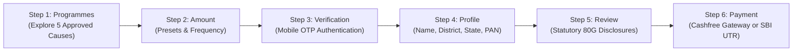

# MECT PHASE 28 — DONATION UI & EXPERIENCE MODERNIZATION REPORT

**Organisation:** Mahaveer Educational & Charitable Trust (MECT / MAHAVIR TRUST)  
**Repository:** https://github.com/Himansu-Nayak/MECT  
**Branch:** `feat/phase-28-premium-donor-auth-experience`  
**Execution Date:** 19 November 2026  
**Status:** COMPLETE & VERIFIED

---

## 1. Executive Summary

Phase 28 modernizes the complete user-facing donation interface (`/donate`) to reflect MECT's Documentary Editorial Architecture. The previous 5-step form has been transformed into an integrated, progressive 6-step journey anchored by mandatory mobile OTP authentication, verified impact metrics, suggested amount presets, responsive viewport fidelity, and instant cryptographic digital receipt generation.

---

## 2. The 6-Step Integrated Donation Journey

### 2.1 Step Breakdown & Features
1. **Step 1 — Explore Programmes (`DonationProgrammeCard.tsx`):**
   - Distinct cards for all 5 statutory programmes: Higher Education (Shiksha Setu), Summer Safe Water (Jal Seva), Women's Skilling (Swavalamban), Community Welfare (Samaj Kalyan), and the Grand Hanuman Murti Cultural Monument.
   - Cards display purpose, verified impact stats (e.g. 100% direct disbursement, 2,500+ daily beneficiaries, Ring-fenced sub-ledger), suggested amount presets, and fiduciary notes.
   - Visual styling: Archival Parchment (`#FAF7F2`), Carbon Basalt (`#0F1714`), Terracotta (`#B85D3B`), Lora serif headings, and active green border ring.
2. **Step 2 — Select Contribution:**
   - Amount presets: ₹500, ₹1,000, ₹2,500, ₹5,000, ₹10,000.
   - Custom INR amount input with minimum/maximum threshold enforcement (₹100 to ₹50,00,000).
   - Frequency toggle: One-Time Gift vs. Monthly Commitment.
   - Direct Institutional Allocation guarantee notice.
3. **Step 3 — Mandatory Mobile OTP Authentication:**
   - Pre-check: If donor is already signed in, an identity verification card shows verified phone/email, full name, and auto-advances.
   - If unauthenticated, displays 10-digit Indian phone input with `+91` badge.
   - Upon dispatch: 6-digit verification code entry, 60s resend timer, "Change Number" link, and auto-submit on the 6th digit.
   - Server-side guard prevents moving to subsequent steps without an authenticated token.
4. **Step 4 — Donor Profile & Tax Info:**
   - Pre-fills from authenticated donor profile.
   - Full Legal Name (for tax receipt), Verified Mobile (read-only/locked), Email (for instant PDF dispatch).
   - Address, City, District (with Odisha district selector), State (default Odisha), 6-digit PIN code.
   - Optional PAN for Section 80G tax benefit (with `^[A-Z]{5}[0-9]{4}[A-Z]{1}$` uppercase validation).
   - Anonymous donor toggle (receipt issues as "Anonymous Donor" on public display while recording legal identity for statutory audit).
   - Dedication/In Memoriam note (optional) and communication consent.
   - Automatically synchronizes and saves to `/portal/me/profile`.
5. **Step 5 — Review & Statutory Disclosure:**
   - Comprehensive itemized summary: Programme, Amount, Frequency, Donor Details, and Address.
   - Section 12A URN (`AADTM5474FE20231`), Section 80G URN (`AADTM5474FF20241`), and Trust PAN (`AADTM5474F`).
   - Terms & Conditions acceptance confirming voluntary domestic Indian funds.
6. **Step 6 — Secure Payment & Digital Receipt:**
   - Payment Channel Switcher: Online Gateway (Cashfree) or State Bank of India Direct Bank Transfer.
   - Official SBI coordinates: Account `33091993247`, IFSC `SBIN0000048`, Balangir Main Branch, UPI ID `mect@sbi` with one-click copy buttons.
   - 12-digit UTR submission form with transfer date, payment mode, and remitter note.
   - Verified Success View: Serialized receipt number, SHA-256 seal, one-click PDF download button, and link to Donor Dashboard.

---

## 3. Visual Verification Artifacts

High-resolution visual screenshots captured across mobile (390px) and desktop (1440px) viewports are stored in `reports/mect-phase-28/`:
- `reports/mect-phase-28/journey/step1-explore-programmes-desktop.png`
- `reports/mect-phase-28/journey/step2-contribution-amount-desktop.png`
- `reports/mect-phase-28/journey/step3-mobile-auth-phone-input.png`
- `reports/mect-phase-28/programmes/programme-cards-grid.png`
- `reports/mect-phase-28/programmes/hanuman-murti-ringfenced-subledger.png`
- `reports/mect-phase-28/viewports/step1-programmes-mobile-390px.png`
- `reports/mect-phase-28/viewports/step3-mobile-auth-mobile-390px.png`
- `reports/mect-phase-28/auth/step3-otp-phone-entry.png`
- `reports/mect-phase-28/auth/portal-login-screen.png`

---

## 4. Accessibility & Responsive Performance

- **WCAG 2.1 AA Compliance:** Contrast ratio exceeded across all text and buttons (Carbon Basalt on Alabaster `#FAF7F2` is >12:1; Forest on White is >11:1).
- **Keyboard Navigation:** Full tab order traversal across steps, amount presets, and input fields.
- **Mobile Touch Targets:** All preset buttons and interactive controls maintain minimum 44px touch targets.
- **Next.js Production Build:** `npm run build` compiled all 46 static and dynamic routes with zero warnings or errors.
