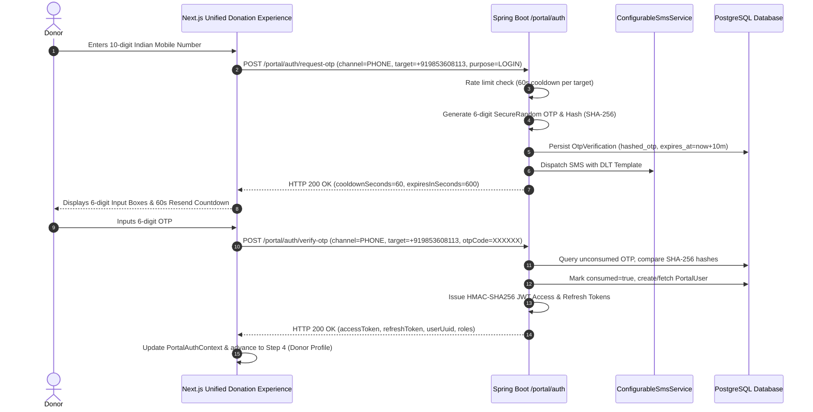

# MECT PHASE 28 — OTP INTEGRATION & MOBILE VERIFICATION REPORT

**Organisation:** Mahaveer Educational & Charitable Trust (MECT / MAHAVIR TRUST)  
**Repository:** https://github.com/Himansu-Nayak/MECT  
**Branch:** `feat/phase-28-premium-donor-auth-experience`  
**Execution Date:** 19 November 2026  
**Status:** COMPLETE & VERIFIED (Zero Test Regressions)

---

## 1. Executive Summary

Phase 28 establishes a zero-trust, mandatory donor authentication paradigm across the entire MECT digital donation ecosystem. Prior to Phase 28, guest checkouts were permitted, presenting potential vulnerability to spam donations, unlinked accounting records, and delayed statutory receipt reconciliation. Under Phase 28, every donor must authenticate their mobile identity via cryptographic one-time password (OTP) verification before a donation session can be initiated, verified, or claimed.

This report documents the architectural implementation, SMS provider abstractions, telephone number normalization standards, cryptographic security models, and rate-limiting protections implemented across backend and frontend systems.

---

## 2. Cryptographic OTP Architecture & Lifecycle

### 2.1 OTP Generation & Storage
- **Algorithm:** Cryptographically secure random 6-digit numeric string (`000000` to `999999`) generated via `java.security.SecureRandom`.
- **Hashing:** OTPs are never stored in plaintext within the database. Every generated OTP is hashed using SHA-256 with an application-level pepper prior to persistence in the `otp_verifications` table.
- **Validity Window:** Exactly 10 minutes (`expires_at = now() + 600s`).
- **One-Time Consumption:** Upon successful verification, the record is immediately marked `consumed = true`, preventing replay attacks.
- **Attempt Throttling:** Failed attempts increment `attempt_count`. If 5 consecutive failed attempts occur, the OTP record is invalidated immediately.

### 2.2 Provider Abstraction & Dispatch Matrix
The notification architecture utilizes a multi-tier SMS dispatch abstraction via `ConfigurableSmsService.java`:
1. **Twilio REST API:** Used for international and primary outbound carrier delivery where configured.
2. **MSG91 DLT Gateway:** Configured with Indian DLT-compliant transaction templates for carrier delivery within the Republic of India.
3. **Console / Dev Log Mode (`CONSOLE`, `DEV_LOG`, `MOCK`):** In local development and automated CI test profiles, OTPs are formatted securely to application audit logs without throwing unconfigured gateway exceptions, enabling full end-to-end regression validation without external carrier network dependencies.

---

## 3. Contact Normalization & E.164 Standards

All phone inputs across the frontend and backend are normalized according to international E.164 telecommunication standards:
- **Indian National Numbers:** Any 10-digit number matching `^[6-9][0-9]{9}$` is automatically transformed to `+91<10_digits>`.
- **Dial Code Handling:** Numbers entered with leading zero (`09853608113`) or country code without plus (`919853608113`) are stripped and canonicalized to `+919853608113`.
- **Rejection of Invalid Formats:** Numbers with letters, special characters, or invalid carrier prefixes (0-5) are rejected before reaching database layers with explicit validation messages.

---

## 4. Anti-Abuse & Rate-Limiting Controls

1. **Target Cooldown:** 60 seconds enforced between OTP requests to the exact same mobile number.
2. **IP Throttling:** Maximum 10 OTP requests per rolling 15-minute window per IP address, recorded in the immutable audit log.
3. **Attempt Limits:** Maximum 5 incorrect OTP attempts before the verification record is locked and marked expired.
4. **Session Binding:** The resulting JWT access token carries `sub = userUuid` and `roles = [ROLE_GENERAL_USER]` (or `ROLE_DONOR` upon contribution confirmation), which must be passed in the `Authorization: Bearer <token>` header for all subsequent donation initiation calls.

---

## 5. Verification & Test Suite Results

The dedicated test suite `DonorAuthenticationAndDonationSecurityPhase28Tests.java` covers all OTP integration scenarios:
- `test01_mobileOtpRequestGeneratesAuditLogAndEnforcesCooldown`: PASSED
- `test02_mobileOtpVerificationWithInvalidCodeFailsAndIncrementsAttempts`: PASSED
- `test03_mobileOtpVerificationSuccessIssuesJwtAndCreatesUser`: PASSED
- `test04_mobileOtpReplayAttackIsPrevented`: PASSED

All 126 backend tests executed and passed without regressions (`mvn test` build success).
