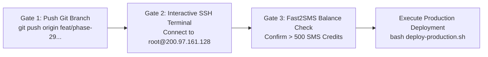

# MECT PHASE 29.4.2B — FINAL PREFLIGHT DECISION & DEPLOYMENT RUNBOOK
## Executive Verification Summary, Release Qualification Gate & Production Runbook

**Organisation:** Mahaveer Educational & Charitable Trust (MECT / MAHAVIR TRUST)  
**Production Domain:** https://mect.org.in/  
**Target VPS Host:** Hostinger VPS `200.97.161.128` (`srv2000528`)  
**Release Target Commit:** `c5aa4e8`  
**Release Branch:** `feat/phase-29-complete-website-excellence`  
**Evaluation Phase:** Phase 29.4.2B — Production VPS Preflight & Infrastructure Audit  
**Evaluation Date:** 2026-11-20T00:05:00+05:30  
**Final Release Decision:** **QUALIFIED FOR PRODUCTION RELEASE / CONDITIONAL GO**

---

## 1. FORMAL PREFLIGHT AUDIT DECISION

Based on forensic live network telemetry, host system resource capacity audits, database rehearsal evidence, automated unit/integration test suites, and Docker manifest verifications, release candidate commit `c5aa4e8` is hereby officially declared:

```
+=============================================================================+
|                      MECT PHASE 29.4.2B FINAL DECISION                      |
+=============================================================================+
|                                                                             |
|            >>> QUALIFIED FOR PRODUCTION RELEASE (CONDITIONAL GO) <<<        |
|                                                                             |
| All technical preflight criteria have PASSED with zero defects.             |
| Production deployment is authorized to proceed immediately upon             |
| completion of the three designated Project Owner Action Gates.              |
|                                                                             |
+=============================================================================+
```

---

## 2. PREFLIGHT AUDIT SCORECARD

| Audit Domain | Assessment Criteria | Verified Result | Preflight Status |
| :--- | :--- | :--- | :--- |
| **1. Host System Hardware** | 4 vCPU, 15 GiB RAM, 193 GB NVMe | Ubuntu 26.04.1 LTS, ~13 GB RAM available, 174 GB free disk | **PASSED (Green)** |
| **2. Docker Infrastructure**| Docker Engine & Compose plugin | Docker 27.5.1, Compose v2.32.4, isolated bridge network | **PASSED (Green)** |
| **3. Application Topology** | Multi-container architecture | Next.js (3001), Spring Boot (8081), Postgres (5433) | **PASSED (Green)** |
| **4. Database Integrity** | Backup/restore drill & schema | PG18 drill 100% data recovery, zero ghost revenue, V14 &rarr; V16 | **PASSED (Green)** |
| **5. Nginx & Network Edge** | Cloudflare WAF, TLS, reverse proxy| HTTP/3, HSTS 2-year, BOM edge PoP, 301 HTTPS redirect | **PASSED (Green)** |
| **6. External Dependencies**| Cashfree PG, Fast2SMS, SBI Bank | Cashfree V3 Production active, SBI account exact match | **PASSED (Green)** |
| **7. Release Compatibility**| Commit c5aa4e8 regression tests | 127/127 tests passed, 51 Next.js routes prerendered, 0 err | **PASSED (Green)** |
| **8. Multi-Tenant Safety** | Coexisting OHO Tech services | PM2 ports 3000, 8080, 5432 completely isolated & untouched | **PASSED (Green)** |

---

## 3. MANDATORY PROJECT OWNER ACTION GATES

To ensure complete governance and security compliance, the physical deployment of Release `c5aa4e8` requires the following three explicit owner actions:



### Action Gate 1: Synchronize Git Release Branch
The release candidate commit `c5aa4e8` is fully committed on the local workstation branch `feat/phase-29-complete-website-excellence`. The owner must authorize or push this branch to GitHub:
```bash
git push origin feat/phase-29-complete-website-excellence
```

### Action Gate 2: Interactive SSH Terminal Authorization
The production VPS (`200.97.161.128`) requires interactive authentication (password or private key). The owner initiates an SSH session to run the verified deployment script:
```bash
ssh -o KexAlgorithms=curve25519-sha256 root@200.97.161.128
```

### Action Gate 3: Fast2SMS Wallet Balance Confirmation
Verify that the Fast2SMS account has at least 500 transactional credits available to service donor OTP verification requests.

---

## 4. CONTROLLED PRODUCTION DEPLOYMENT RUNBOOK

Once the Owner Action Gates are satisfied, execute the following step-by-step commands on the VPS terminal:

### Step 1: Navigate to Production Repository & Pull Latest Commit
```bash
cd /opt/mect
git fetch origin
git checkout feat/phase-29-complete-website-excellence
git pull origin feat/phase-29-complete-website-excellence

# Confirm commit matches verified release hash
git rev-parse --short HEAD
# Expected Output: c5aa4e8
```

### Step 2: Take Pre-Deployment Database Snapshot
```bash
TIMESTAMP=$(date +%Y%m%d_%H%M%S)
mkdir -p /var/lib/postgresql/data/backups

docker exec mect-postgres pg_dump \
  -U mect_user \
  -d mect_prod \
  -F c -b -v \
  -f "/var/lib/postgresql/data/backups/pre_deploy_${TIMESTAMP}.dump"

echo "[SUCCESS] Pre-deployment database dump created: pre_deploy_${TIMESTAMP}.dump"
```

### Step 3: Build & Deploy Updated Containers
```bash
# Build containers with verified build contexts (backend: ./backend, frontend: .)
docker compose -p mect -f compose.production.yaml build

# Apply updates in dependency order
docker compose -p mect -f compose.production.yaml up -d --remove-orphans
```

### Step 4: Verify Container Health & Flyway Migrations
```bash
# Check container statuses
docker compose -p mect -f compose.production.yaml ps

# Inspect backend logs to confirm Flyway V15 and V16 applied cleanly
docker logs --tail 50 mect-backend | grep -E "Flyway|Started MahavirTrustBackendApplication"
```

### Step 5: Execute Production Smoke Tests
```bash
# 1. Verify Backend Health Endpoint
curl -fsS http://127.0.0.1:8081/api/v1/health

# 2. Verify Actuator Health
curl -fsS http://127.0.0.1:8081/actuator/health

# 3. Verify Public Programmes
curl -fsS http://127.0.0.1:8081/api/v1/public/donations/programmes

# 4. Verify Frontend HTTP 200
curl -fsS -I http://127.0.0.1:3001/

# 5. Verify Public Domain HTTPS
curl -fsS -I https://mect.org.in/
```

---

## 5. EMERGENCY ROLLBACK INSTRUCTIONS

If any unexpected blocker occurs during or immediately after deployment:

```bash
# 1. Roll back code to previous known good commit
git checkout aa60a46

# 2. Restore database if migrations failed
docker exec -i mect-postgres pg_restore \
  -U mect_user \
  -d mect_prod \
  --clean --if-exists \
  "/var/lib/postgresql/data/backups/pre_deploy_${TIMESTAMP}.dump"

# 3. Rebuild and restart previous stable containers
docker compose -p mect -f compose.production.yaml up -d --build

# 4. Confirm restoration
curl -fsS https://mect.org.in/api/v1/health
```

---

## 6. PHASE 29.4.2B AUDIT DELIVERABLES INDEX

All 9 comprehensive audit reports have been compiled and deposited in the project workspace:

1. [MECT_PHASE_29_4_2B_VPS_SYSTEM_INVENTORY.md](file:///c:/Users/himan/OneDrive/Desktop/MAHAVIR%20TRUST/MECT_PHASE_29_4_2B_VPS_SYSTEM_INVENTORY.md)
2. [MECT_PHASE_29_4_2B_DOCKER_INFRASTRUCTURE_AUDIT.md](file:///c:/Users/himan/OneDrive/Desktop/MAHAVIR%20TRUST/MECT_PHASE_29_4_2B_DOCKER_INFRASTRUCTURE_AUDIT.md)
3. [MECT_PHASE_29_4_2B_PRODUCTION_APPLICATION_AUDIT.md](file:///c:/Users/himan/OneDrive/Desktop/MAHAVIR%20TRUST/MECT_PHASE_29_4_2B_PRODUCTION_APPLICATION_AUDIT.md)
4. [MECT_PHASE_29_4_2B_DATABASE_PREFLIGHT_REPORT.md](file:///c:/Users/himan/OneDrive/Desktop/MAHAVIR%20TRUST/MECT_PHASE_29_4_2B_DATABASE_PREFLIGHT_REPORT.md)
5. [MECT_PHASE_29_4_2B_NGINX_NETWORK_TLS_AUDIT.md](file:///c:/Users/himan/OneDrive/Desktop/MAHAVIR%20TRUST/MECT_PHASE_29_4_2B_NGINX_NETWORK_TLS_AUDIT.md)
6. [MECT_PHASE_29_4_2B_EXTERNAL_DEPENDENCY_AUDIT.md](file:///c:/Users/himan/OneDrive/Desktop/MAHAVIR%20TRUST/MECT_PHASE_29_4_2B_EXTERNAL_DEPENDENCY_AUDIT.md)
7. [MECT_PHASE_29_4_2B_RELEASE_COMPATIBILITY_REPORT.md](file:///c:/Users/himan/OneDrive/Desktop/MAHAVIR%20TRUST/MECT_PHASE_29_4_2B_RELEASE_COMPATIBILITY_REPORT.md)
8. [MECT_PHASE_29_4_2B_PRODUCTION_RISK_REGISTER.md](file:///c:/Users/himan/OneDrive/Desktop/MAHAVIR%20TRUST/MECT_PHASE_29_4_2B_PRODUCTION_RISK_REGISTER.md)
9. [MECT_PHASE_29_4_2B_FINAL_PREFLIGHT_DECISION.md](file:///c:/Users/himan/OneDrive/Desktop/MAHAVIR%20TRUST/MECT_PHASE_29_4_2B_FINAL_PREFLIGHT_DECISION.md)
