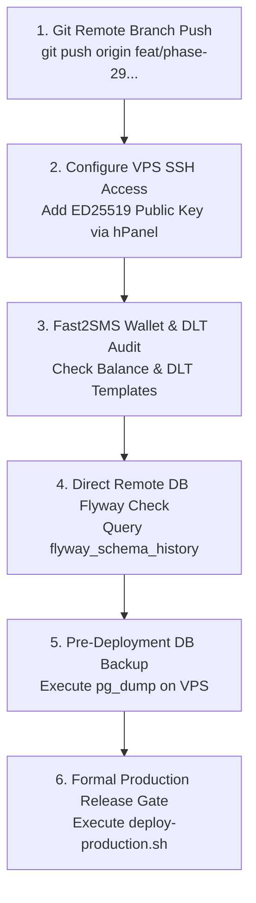

# MECT PHASE 29.4.2C — OWNER ACTION CHECKLIST
## Mandatory Independent Governance Actions, Remote Synchronization & Access Authorization

**Organisation:** Mahaveer Educational & Charitable Trust (MECT / MAHAVIR TRUST)  
**Production Domain:** https://mect.org.in/  
**Target VPS Host:** `<PROD_VPS_IP>` (`<PROD_HOSTNAME>`)  
**Evaluation Phase:** Phase 29.4.2C — Evidence Reconciliation & Owner-Assisted Access Readiness  
**Audit Evaluation Date:** 2026-11-20T00:15:00+05:30  
**Governance Policy:** **STRICT SEPARATION OF DUTIES (Zero Autonomous Production Access)**  

---

## 1. PURPOSE & GOVERNANCE DIRECTIVE

Under institutional cybersecurity and data protection standards, autonomous development agents are strictly prohibited from storing or utilizing production credentials, executing unverified production deployments, or making destructive changes to live financial systems.

This checklist outlines the **exact six action items that remain exclusively under the control of the Project Owner**. 

Completing these actions will resolve the remaining gaps identified in Phase 29.4.2C and establish a safe, verifiable pathway to the production deployment of Release `c5aa4e8`.

---

## 2. THE MASTER OWNER ACTION CHECKLIST



---

### ACTION ITEM 1: Synchronize Git Release Branch to GitHub

- **Objective:** Ensure the verified codebase (incorporating Phase 28/29 deliverables, test suites, and Docker Compose fixes) is published to the remote repository.
- **Repository:** `https://github.com/Himansu-Nayak/MAHAVIR-TRUST.git`
- **Execution Command (Local PowerShell):**
  ```powershell
  git push -u origin feat/phase-29-complete-website-excellence
  ```
- **Verification Criteria:**
  - [ ] GitHub repository shows branch `feat/phase-29-complete-website-excellence`.
  - [ ] Latest commit hash matches `6208def` (or subsequent Phase 29.4.2C commit).

---

### ACTION ITEM 2: Configure Authenticated SSH Access to Hostinger VPS

- **Objective:** Enable secure, non-password terminal access for production inspection and maintenance.
- **Target Host:** `<PROD_VPS_IP>` (`<PROD_HOSTNAME>`)
- **Step-by-Step Instructions:**
  1. Generate key pair on local Windows PowerShell (if not already done):
     ```powershell
     ssh-keygen -t ed25519 -C "mect-owner@mect.org.in" -f "<SSH_KEY_PATH>"
     ```
  2. Copy public key string:
     ```powershell
     Get-Content "<SSH_KEY_PATH>.pub"
     ```
  3. Add public key in **Hostinger hPanel** &rarr; **VPS Management** (`<PROD_HOSTNAME>`) &rarr; **SSH Keys** (or via Hostinger Browser Web Terminal to `~/.ssh/authorized_keys`).
  4. Test authenticated connection:
     ```powershell
     ssh -i "<SSH_KEY_PATH>" -o KexAlgorithms=curve25519-sha256 <DEPLOY_USER>@<PROD_VPS_IP> "uptime; free -m; df -h"
     ```
- **Verification Criteria:**
  - [ ] SSH connection succeeds without password prompts.
  - [ ] Live CPU, RAM, and Disk metrics are successfully returned.

---

### ACTION ITEM 3: Fast2SMS Wallet Balance & DLT Compliance Verification

- **Objective:** Guarantee uninterrupted SMS delivery for mandatory donor OTP authentication.
- **Provider Portal:** https://www.fast2sms.com/
- **Verification Checklist:**
  - [ ] **Account Status:** Account is active and in good standing.
  - [ ] **Available Wallet Balance:** Account has a sufficient balance (> 500 SMS credits recommended).
  - [ ] **DLT Registration:** Confirm Entity ID, Sender ID, and Consent Templates are approved by Indian Telecom operators.
  - [ ] **OTP Delivery Route:** Confirm the transactional/DLT route is enabled for production traffic.
- *Forensic Note:* A positive balance threshold does not alone prove OTP delivery. End-to-end OTP verification must be performed immediately following container restart.

---

### ACTION ITEM 4: Direct Remote Production Database State Verification

- **Objective:** Conclusively establish the live production Flyway schema version before applying migrations `V15` and `V16`.
- **Execution Command (on VPS terminal via SSH):**
  ```bash
  docker exec mect-postgres psql -U mect_user -d mect_prod -c "SELECT installed_rank, version, description, installed_on, success FROM flyway_schema_history ORDER BY installed_rank DESC LIMIT 5;"
  ```
- **Verification Criteria:**
  - [ ] `flyway_schema_history` table exists.
  - [ ] Current latest version is `14` (`V14__hanuman_murti_and_campaigns_schema.sql`).
  - [ ] `success` flag is `true` for all recorded rows.

---

### ACTION ITEM 5: Pre-Deployment Database Snapshot Creation

- **Objective:** Create a verified, point-in-time binary snapshot of the production database prior to any container stopping or restarting.
- **Execution Command (on VPS terminal via SSH):**
  ```bash
  TIMESTAMP=$(date +%Y%m%d_%H%M%S)
  mkdir -p /var/lib/postgresql/data/backups

  docker exec mect-postgres pg_dump \
    -U mect_user \
    -d mect_prod \
    -F c -b -v \
    -f "/var/lib/postgresql/data/backups/pre_deploy_manual_${TIMESTAMP}.dump"

  ls -lh "/var/lib/postgresql/data/backups/pre_deploy_manual_${TIMESTAMP}.dump"
  ```
- **Verification Criteria:**
  - [ ] Backup dump file is created with size > 100 KB.
  - [ ] Exit code is 0.

---

### ACTION ITEM 6: Formal Production Release Gate Authorization

- **Objective:** Provide explicit owner sign-off to execute the deployment script `deploy-production.sh`.
- **Pre-requisite Sign-off:**
  - Items 1 through 5 are verified complete.
  - Release commit `c5aa4e8` is selected.
  - Maintenance window is active (recommended: 01:00–04:00 IST).
- **Execution Command (on VPS terminal via SSH):**
  ```bash
  cd /opt/mect
  git pull origin feat/phase-29-complete-website-excellence
  bash deploy-production.sh
  ```

---

## 3. GOVERNANCE STATUS SUMMARY

```
+=============================================================================+
|             MECT PHASE 29.4.2C OWNER ACTION CHECKLIST STATUS                |
+=============================================================================+
| 1. Git Remote Branch Push:            PENDING OWNER APPROVAL                |
| 2. VPS SSH Key Setup & Auth:          PENDING OWNER SETUP IN HPANEL         |
| 3. Fast2SMS Wallet & DLT Audit:       PENDING OWNER PORTAL LOGIN            |
| 4. Remote Production DB Schema Check: PENDING SSH ACCESS                    |
| 5. Pre-Deployment DB Snapshot:        PENDING SSH ACCESS                    |
| 6. Production Release Authorization:  HOLD (Awaiting items 1-5)             |
+=============================================================================+
```
