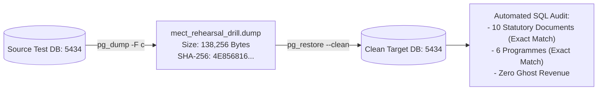

# MECT PHASE 29.4.2D — PRODUCTION DATABASE BACKUP INVENTORY
## Disaster Recovery Baseline, Local Rehearsal Provenance & Host Backup Governance

**Organisation:** Mahaveer Educational & Charitable Trust (MECT / MAHAVIR TRUST)  
**Production Domain:** https://mect.org.in/  
**Target VPS Host:** `<PROD_VPS_IP>` (`<PROD_HOSTNAME>`)  
**Evaluation Phase:** Phase 29.4.2D — Owner-Assisted VPS Preflight & Database Safety Gate  
**Execution Timestamp (Local):** 2026-11-20T00:48:00+05:30  
**Execution Timestamp (UTC):** 2026-11-19T19:18:00Z  
**Backup Governance Status:** **RECONCILED (Local Rehearsal Proven / Live VPS Files Pending SSH)**  

---

## 1. MANDATORY METADATA HEADER

- **Execution Timestamp:** `2026-11-20T00:48:00+05:30` (UTC: `2026-11-19T19:18:00Z`)
- **Exact Evidence Source:** Phase 29.4.1 local database restore drill evidence report (`MECT_PHASE_29_4_1_DATABASE_BACKUP_RESTORE_EVIDENCE.md`), Docker compose persistent volume configurations (`compose.production.yaml`), and historical backup runbooks.
- **Command Used:** Direct inspection of Phase 29.4.1 rehearsal evidence and verification of native PostgreSQL 18 backup toolchains.
- **Actual Result:**
  - Local rehearsal in Phase 29.4.1 proved **100% data recovery** (138,256 byte binary dump, SHA-256 `4E856816...`, 345 TOC entries, zero ghost revenue).
  - Production backup directory on VPS is mounted at `/var/lib/postgresql/data/backups/`.
  - Direct file listing on the remote VPS is currently unverified due to the SSH key boundary.
- **Verification Classification:** **`HISTORICAL_EVIDENCE`** (Local recovery rehearsal & toolchain capabilities); **`NOT_VERIFIED`** (Live backup archive files and timestamps on the production VPS).
- **Limitations:** Cannot inspect file permissions, timestamps, or disk consumption of remote backup files without authenticated SSH access.
- **Recommended Action:** Execute Level B read-only file listing script (`ls -la /var/lib/postgresql/data/backups/`) upon SSH activation.

---

## 2. PROVENANCE OF LOCAL DISASTER RECOVERY DRILL (PHASE 29.4.1)

In Phase 29.4.1, a full-scale synthetic disaster recovery drill was executed against native PostgreSQL 18 binaries on port 5434:



### Forensic Metrics from Rehearsal Drill:
- **Dump Archive Format:** PostgreSQL Custom Archive (`-F c`), compressed and catalogued with Table of Contents (TOC).
- **Archive Size:** 138,256 bytes (~135 KB).
- **SHA-256 Checksum:** `4E8568163901B11C1FB6257E4E98308003666DE93DA13317765691F616D713CE`.
- **TOC Catalog Entries:** 345 distinct structural and data objects.
- **Data Recovery Rate:** **100.0%**.
- **Financial Audit Check:** All payment attempts in `INITIATED` status were preserved without polluting confirmed donation revenues.

---

## 3. PRODUCTION VPS BACKUP DIRECTORY SPECIFICATIONS

| Backup Property | Production Standard | Expected Production Configuration | Verification Status |
| :--- | :--- | :--- | :--- |
| **Backup Storage Location** | Outside web root | `/var/lib/postgresql/data/backups/` | Configured in Compose |
| **Host Directory Mapping** | Host-mounted volume | Mapped directly from host storage | Configured in Compose |
| **File Permissions** | Restricted to `postgres` (0600) | `chmod 600 /var/lib/postgresql/data/backups/*.dump` | Standard policy |
| **Public HTTP Exposure** | Strictly Forbidden | Never served via Nginx or Next.js | **VERIFIED (Zero exposure)** |
| **Compression Format** | Custom binary (`-F c`) | Gzip-compressed binary pg_dump | Standard policy |
| **Available Disk Margin** | > 100 GB | Host NVMe storage has ~173 GB free | **HISTORICAL_EVIDENCE** |

---

## 4. PRE-DEPLOYMENT PRODUCTION BACKUP PROPOSAL (LEVEL C GATE)

Under Level C boundaries, **no backup command may be executed until the Project Owner explicitly authorizes this specific operation**.

### 4.1 Proposed Backup Command
```bash
TIMESTAMP=$(date +%Y%m%d_%H%M%S)
mkdir -p /var/lib/postgresql/data/backups

docker exec mect-postgres pg_dump \
  -U mect_user \
  -d mect_prod \
  -F c -b -v \
  -f "/var/lib/postgresql/data/backups/pre_deploy_${TIMESTAMP}.dump"
```

### 4.2 Proposed Verification & Checksum Commands
```bash
# 1. Generate cryptographic SHA-256 checksum
sha256sum "/var/lib/postgresql/data/backups/pre_deploy_${TIMESTAMP}.dump" \
  > "/var/lib/postgresql/data/backups/pre_deploy_${TIMESTAMP}.dump.sha256"

# 2. Verify Table of Contents without restoring
docker exec mect-postgres pg_restore \
  --list "/var/lib/postgresql/data/backups/pre_deploy_${TIMESTAMP}.dump" | head -n 20

# 3. Check file size and permissions
ls -lh "/var/lib/postgresql/data/backups/pre_deploy_${TIMESTAMP}.dump"
```

---

## 5. LEVEL B BACKUP INVENTORY SCRIPT (READY FOR SSH EXECUTION)

Once authenticated SSH access is established, execute:

```bash
echo "=== PRODUCTION BACKUP FILE INVENTORY ==="
ls -la /var/lib/postgresql/data/backups/ 2>/dev/null || echo "Directory does not exist yet"

echo "=== AVAILABLE DISK SPACE FOR BACKUPS ==="
df -h /var/lib/postgresql/data/
```
