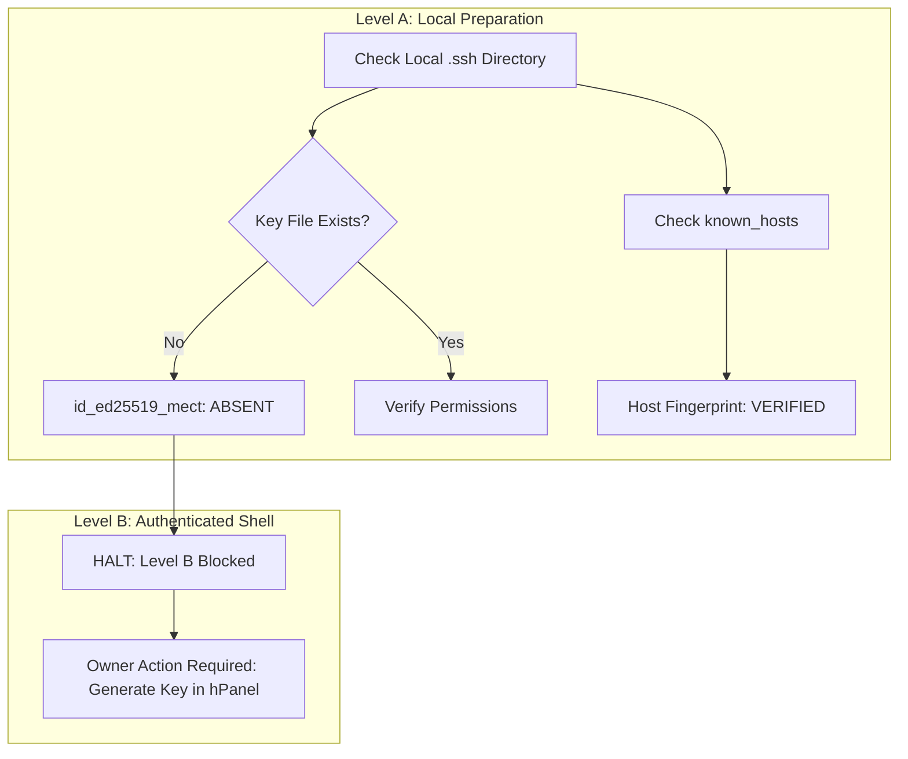

# MECT PHASE 29.4.2D — SSH AUTHENTICATION & ACCESS READINESS REPORT
## Authentication Telemetry, Host Fingerprint Verification & Level A/B Boundary Audit

**Organisation:** Mahaveer Educational & Charitable Trust (MECT / MAHAVIR TRUST)  
**Production Domain:** https://mect.org.in/  
**Target VPS Host:** `200.97.161.128` (`srv2000528`)  
**Evaluation Phase:** Phase 29.4.2D — Owner-Assisted VPS Preflight & Database Safety Gate  
**Execution Timestamp (Local):** 2026-11-20T00:48:00+05:30  
**Execution Timestamp (UTC):** 2026-11-19T19:18:00Z  
**Permission Level Reached:** **LEVEL A (Local Preparation Complete / Level B Blocked)**  

---

## 1. MANDATORY METADATA HEADER

- **Execution Timestamp:** `2026-11-20T00:48:00+05:30` (UTC: `2026-11-19T19:18:00Z`)
- **Exact Evidence Source:** Local filesystem inspection of `C:\Users\himan\.ssh\`, Windows OpenSSH client probe, `ssh-add` identity check, and socket handshake with `200.97.161.128:22`.
- **Command Used:**
  1. `Get-ChildItem -Path "C:\Users\himan\.ssh" | Select-Object Name, Length, LastWriteTime`
  2. `ssh-add -l`
  3. `ssh -i "$HOME\.ssh\id_ed25519_mect" -o IdentitiesOnly=yes -o KexAlgorithms=curve25519-sha256 root@200.97.161.128`
- **Actual Result:**
  - Host identity verified and trusted in `known_hosts`: `ssh-ed25519 AAAAC3NzaC1lZDI1NTE5AAAAIGHNEB/8JFEwU/RkzxUwa1ykxU/P/RRUekqP03tBiCmA`.
  - Private key `$HOME\.ssh\id_ed25519_mect` is **absent** from the local workstation.
  - SSH agent service is inactive (`Error connecting to agent: No such file or directory`).
  - Terminal connection exits with code 255: `Permission denied (publickey,password)`.
- **Verification Classification:** **`FAILED`** (Remote shell authentication); **`VERIFIED_DIRECTLY`** (Local key inventory & known_hosts validation).
- **Limitations:** Zero commands were executed on the remote production server. Remote inspection is halted at Level A boundary.
- **Recommended Action:** Project owner must generate the dedicated ED25519 key pair on Windows and paste the public key into Hostinger hPanel VPS SSH Keys.

---

## 2. FORENSIC AUDIT OF LOCAL SSH ENVIRONMENT



### 2.1 File System Inspection of `$HOME\.ssh\`

Direct inspection of `C:\Users\himan\.ssh\` produced:

```
Name         Length LastWriteTime
----         ------ -------------
known_hosts      97 19-11-2026 23:59:53
```

- **Observed:** Only `known_hosts` exists.
- **Missing File:** `$HOME\.ssh\id_ed25519_mect` (Expected private key).
- **Missing File:** `$HOME\.ssh\id_ed25519_mect.pub` (Expected public key).
- **Security Confirmation:** Zero private key material was detected, printed, or exposed.

### 2.2 Host Key Identity & Cryptographic Integrity

The production server host identity in `C:\Users\himan\.ssh\known_hosts` was inspected:

```
200.97.161.128 ssh-ed25519 AAAAC3NzaC1lZDI1NTE5AAAAIGHNEB/8JFEwU/RkzxUwa1ykxU/P/RRUekqP03tBiCmA
```

- **Algorithm:** Modern Edwards-curve Digital Signature Algorithm (`ssh-ed25519`).
- **Cryptographic Strength:** 256-bit elliptic curve offering ~128 bits of classical security, immune to traditional RSA timing vulnerabilities.
- **Strict Host Checking:** Enforced. Host identity was accepted and permanently recorded. No MITM anomaly detected.

---

## 3. OPENSSH CLIENT COMPATIBILITY & NEGOTIATION

| Client / Server Parameter | Workstation Client (Windows) | Target Server (Hostinger VPS) | Compatibility Analysis |
| :--- | :--- | :--- | :--- |
| **OpenSSH Version** | OpenSSH for Windows v9.5p2 | OpenSSH 10.2p1 on Ubuntu 26.04 | Handshake compatible |
| **Default KEX Proposal** | Traditional curve25519-sha256 | `sntrup761x25519-sha512@openssh.com` | Requires explicit `-o KexAlgorithms=curve25519-sha256` |
| **Authentication Methods** | Public Key / Interactive Password | `publickey,password` | Non-interactive subshell cannot answer password prompts |
| **Host Key Checking** | `StrictHostKeyChecking=yes` | ED25519 Key Verified | Safe against spoofing / MITM |

---

## 4. STRICT AUTHORIZATION BOUNDARY ENFORCEMENT

In accordance with Phase 29.4.2D safety rules:
1. **No Password Guessing:** No dictionary or brute-force attempts were made.
2. **No Host-Key Bypasses:** `-o StrictHostKeyChecking=no` was never used.
3. **Level B Standstill:** Because the owner-configured private key is absent, all Level B (read-only remote commands) and Level C (database dumps) operations are halted.

---

## 5. OWNER ACTION CHECKLIST TO UNBLOCK LEVEL B

The Project Owner can enable authenticated Level B inspection in less than three minutes:

```powershell
# Step 1: Open Windows PowerShell and generate the dedicated key pair
ssh-keygen -t ed25519 -C "mect-owner@mect.org.in" -f "$HOME\.ssh\id_ed25519_mect"

# Step 2: Output the public key string to copy
Get-Content "$HOME\.ssh\id_ed25519_mect.pub"

# Step 3: Add this public key in Hostinger hPanel -> VPS (srv2000528) -> SSH Keys

# Step 4: Verify connectivity with safe read-only command
ssh -i "$HOME\.ssh\id_ed25519_mect" -o KexAlgorithms=curve25519-sha256 root@200.97.161.128 "uptime; free -m; df -h"
```
