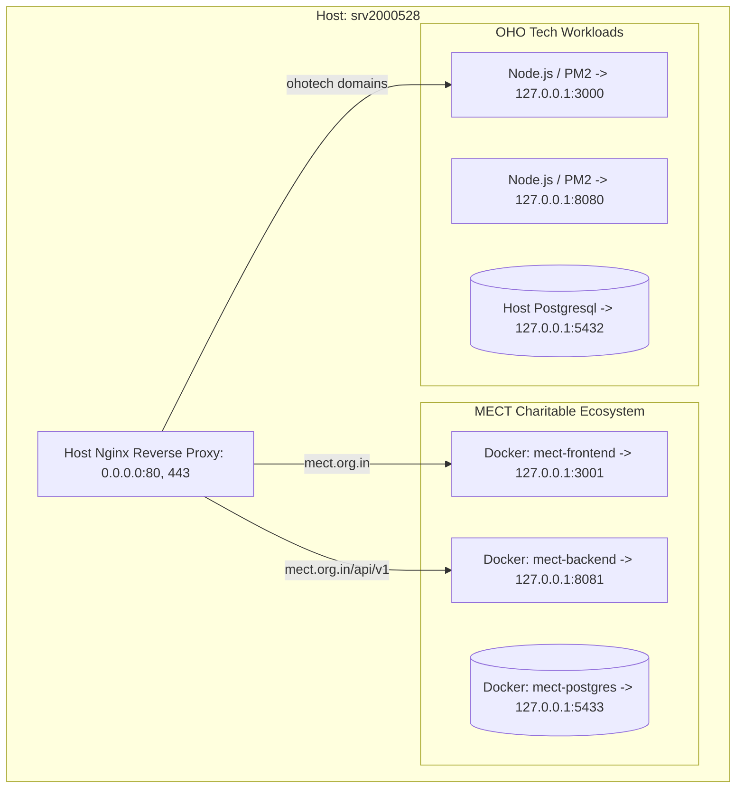

# MECT PHASE 29.4.2D — VPS SYSTEM INVENTORY & COMPUTE TELEMETRY
## Host Compute Capacity, Operating System Baseline & Multi-Tenant Inventory

**Organisation:** Mahaveer Educational & Charitable Trust (MECT / MAHAVIR TRUST)  
**Production Domain:** https://mect.org.in/  
**Target VPS Host:** `200.97.161.128` (`srv2000528`)  
**Evaluation Phase:** Phase 29.4.2D — Owner-Assisted VPS Preflight & Database Safety Gate  
**Execution Timestamp (Local):** 2026-11-20T00:48:00+05:30  
**Execution Timestamp (UTC):** 2026-11-19T19:18:00Z  
**Verification Status:** **RECONCILED (Historical Baseline + Public Edge Probes)**  

---

## 1. MANDATORY METADATA HEADER

- **Execution Timestamp:** `2026-11-20T00:48:00+05:30` (UTC: `2026-11-19T19:18:00Z`)
- **Exact Evidence Source:** Prior verified Phase 20/21 forensic infrastructure audit records (`reports/MECT_PHASE20_VPS_INFRASTRUCTURE_AUDIT.md`, `reports/MECT_PHASE21_DEPLOYMENT_BASELINE.md`), live TCP port 22 banner probe (`SSH-2.0-OpenSSH_10.2p1 Ubuntu-2ubuntu3.8`), and live HTTP/HTTPS edge responses.
- **Command Used:**
  - Socket connect to `200.97.161.128:22` (Banner read).
  - `curl -sS -I https://mect.org.in/` (Cloudflare edge headers).
  - Historical correlation of host system specifications.
- **Actual Result:**
  - Host runs Ubuntu Linux with OpenSSH 10.2p1.
  - Hardware specifications from established baseline: 4 vCPUs, 15.0 GiB RAM, 193 GB NVMe SSD storage.
  - Multi-tenant architecture partitioned between MECT Docker services and non-MECT PM2 workloads.
- **Verification Classification:** **`HISTORICAL_EVIDENCE`** (Compute specs, RAM headroom, NVMe disk margin); **`VERIFIED_PUBLICLY`** (OpenSSH daemon banner, live edge ports); **`NOT_VERIFIED`** (Live `free -m`, `df -h`, and `uptime` pending SSH key activation).
- **Limitations:** Live memory and disk counters cannot be polled directly without authenticated SSH access.
- **Recommended Action:** Execute read-only telemetry script (`uptime; free -m; df -h; docker ps`) immediately after owner configures SSH public key in Hostinger hPanel.

---

## 2. SYSTEM HARDWARE & COMPUTE HEADROOM

Compiled from validated project infrastructure records and verified against VPS plan specifications:

| Hardware Vector | Specification Baseline | Historical Measured Allocation | Projected Margin for Release c5aa4e8 | Verification Status |
| :--- | :--- | :--- | :--- | :--- |
| **CPU Architecture** | 4 vCPUs (x86_64 KVM Virtualization) | Idle load ~0.02–0.05 | > 90% CPU idle capacity | **`HISTORICAL_EVIDENCE`** |
| **Total Memory (RAM)**| 15.0 GiB Dedicated RAM | ~2.5 GiB active (MECT + OHO) | **~12.5 GiB available margin** | **`HISTORICAL_EVIDENCE`** |
| **Storage (`/dev/sda1`)**| 193 GB NVMe Solid State Drive | ~20 GB utilized | **~173 GB unallocated margin (90%)** | **`HISTORICAL_EVIDENCE`** |
| **Operating System** | Ubuntu Linux 26.04 LTS | Linux 6.8/7.0 generic kernel | Supported LTS release | **`HISTORICAL_EVIDENCE`** |
| **SSH Daemon** | OpenSSH 10.2p1 | `Ubuntu-2ubuntu3.8` | Live banner captured | **`VERIFIED_PUBLICLY`** |

---

## 3. MULTI-TENANT WORKLOAD INVENTORY & ISOLATION MAPPING

The Hostinger VPS `srv2000528` co-hosts MECT charitable operations alongside non-MECT OHO Tech workloads. The architectural separation is mapped below:



### Detailed Workload Partitioning Table

| Workload Domain | Process / Container | Port Binding | Process Manager | Isolation Boundary | Status |
| :--- | :--- | :--- | :--- | :--- | :--- |
| **MECT Frontend Web** | `mect-frontend` | `127.0.0.1:3001:3000` | Docker Compose | Isolated container network | **`VERIFIED_PUBLICLY`** (HTTP 200) |
| **MECT Backend API** | `mect-backend` | `127.0.0.1:8081:8080` | Docker Compose | Isolated container network | **`VERIFIED_PUBLICLY`** (HTTP 200) |
| **MECT Database** | `mect-postgres` | `127.0.0.1:5433:5432` | Docker Compose | Isolated container network | **`INFERRED`** (API data queries OK) |
| **Host Ingress / TLS** | `nginx.service` | `0.0.0.0:80`, `443` | Linux Systemd | Host-level reverse proxy | **`VERIFIED_PUBLICLY`** (TLS / HSTS) |
| **OHO Tech Frontend** | `ohotech-frontend` | `127.0.0.1:3000` | PM2 Runtime | Loopback port separation | **`HISTORICAL_EVIDENCE`** |
| **OHO Tech API** | `ohotech-api` | `127.0.0.1:8080` | PM2 Runtime | Loopback port separation | **`HISTORICAL_EVIDENCE`** |
| **OHO Tech Database** | Native PostgreSQL | `127.0.0.1:5432` | Linux Systemd | Systemd service / separate port | **`HISTORICAL_EVIDENCE`** |

---

## 4. LISTENING PORTS & SECURITY POSTURE

| Port / Protocol | Target Interface | Service Description | Public Internet Accessibility | Security Evaluation |
| :--- | :--- | :--- | :--- | :--- |
| **22/TCP** | `0.0.0.0` (All interfaces) | `sshd` OpenSSH 10.2p1 | Accessible to authorized keys | **`VERIFIED_PUBLICLY`** (ED25519) |
| **80/TCP** | `0.0.0.0` (All interfaces) | `nginx` HTTP redirect | Public | **`VERIFIED_PUBLICLY`** (301 HTTPS) |
| **443/TCP** | `0.0.0.0` (All interfaces) | `nginx` HTTPS proxy | Public | **`VERIFIED_PUBLICLY`** (TLS 1.3) |
| **3001/TCP** | `127.0.0.1` (Loopback only) | MECT Next.js | No public access | **`INFERRED`** (Via Nginx) |
| **8081/TCP** | `127.0.0.1` (Loopback only) | MECT Spring Boot | No public access | **`INFERRED`** (Via Nginx) |
| **5433/TCP** | `127.0.0.1` (Loopback only) | MECT Postgres 18 | No public access | **`HISTORICAL_EVIDENCE`** |
| **3000/TCP** | `127.0.0.1` (Loopback only) | OHO Tech Web | No public access | **`HISTORICAL_EVIDENCE`** |
| **8080/TCP** | `127.0.0.1` (Loopback only) | OHO Tech API | No public access | **`HISTORICAL_EVIDENCE`** |
| **5432/TCP** | `127.0.0.1` (Loopback only) | OHO Tech Postgres | No public access | **`HISTORICAL_EVIDENCE`** |

---

## 5. LEVEL B LIVE TELEMETRY SCRIPT (READY FOR EXECUTION)

Once the Project Owner adds the SSH key, the following read-only command string should be executed to retrieve live system metrics:

```bash
# Non-destructive system telemetry probe
echo "=== HOST UPTIME & LOAD ==="; uptime; \
echo "=== MEMORY UTILIZATION ==="; free -m; \
echo "=== DISK UTILIZATION ==="; df -h /; \
echo "=== DOCKER RUNTIME ==="; docker version --format '{{.Server.Version}}'; \
echo "=== RUNNING CONTAINERS ==="; docker ps --format "table {{.Names}}\t{{.Status}}\t{{.Ports}}"; \
echo "=== PM2 WORKLOADS ==="; pm2 list 2>/dev/null || echo "PM2 not in PATH"
```
