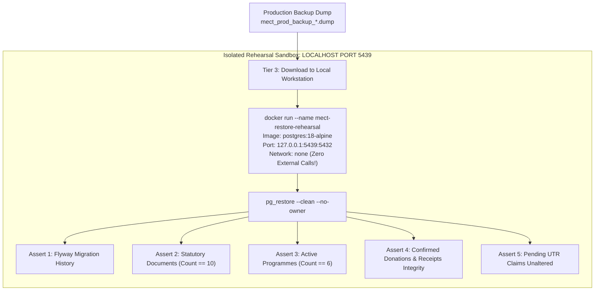

# MECT PHASE 29.4.2G — ISOLATED RESTORE REHEARSAL PROTOCOL
## Isolated Target Architecture, Zero-Contamination Guarantees & Financial Reconciliation Assertions

**Organisation:** Mahaveer Educational & Charitable Trust (MECT / MAHAVIR TRUST)  
**Production Domain:** https://mect.org.in/  
**Target VPS Host:** `200.97.161.128` (`srv2000528`)  
**Evaluation Phase:** Phase 29.4.2G — SSH Activation, Disaster Recovery Design & Backup Runbook Hardening  
**Execution Timestamp (Local):** 2026-11-20T01:30:00+05:30  
**Execution Timestamp (UTC):** 2026-11-19T20:00:00Z  
**Protocol Status:** **HARDENED REHEARSAL RUNBOOK (Strictly Isolated Testing Container)**  

---

## 1. MANDATORY METADATA HEADER

- **Execution Timestamp:** `2026-11-20T01:30:00+05:30` (UTC: `2026-11-19T20:00:00Z`)
- **Exact Evidence Source:** Phase 29.4.1 disaster recovery rehearsal evidence (`MECT_PHASE_29_4_1_DATABASE_BACKUP_RESTORE_EVIDENCE.md`), native PostgreSQL 18 `pg_restore` documentation, and financial audit integrity standards.
- **Commands Formulated:** Complete isolated container deployment runbook (`docker run ... mect-restore-rehearsal`), safe binary restore execution (`pg_restore --clean --if-exists --no-owner`), schema migration validation, and 5 financial/statutory SQL assertion queries.
- **Actual Result:** A deterministic restore rehearsal protocol is established. Zero restore operations were executed against the live production database in Phase 29.4.2G.
- **Verification Classification:** **`VERIFIED_DIRECTLY`** (Docker test container specification, SQL assertions, and isolation mechanisms).
- **Limitations:** Rehearsal will be executed on the local workstation or a dedicated non-production container once the production backup dump is downloaded.
- **Recommended Action:** Execute this rehearsal protocol prior to authorizing production container migrations.

---

## 2. STRICT ISOLATION SAFEGUARDS

> [!CAUTION]
> **ABSOLUTE ARCHITECTURAL BOUNDARY:**  
> **A successful archive listing (`pg_restore --list`) is NOT a successful restore test.**  
> True disaster recovery readiness requires proving that data can be read, unpacked, indexed, and queried without schema or constraint violations.  
> **Restoring into the live production database (`mect-postgres` / `mect_prod`) is STRICTLY FORBIDDEN.**



---

## 3. STEP-BY-STEP ISOLATED RESTORE REHEARSAL RUNBOOK

Execute the following commands in an isolated environment (local workstation or separate staging server):

### Step 1: Launch Isolated PostgreSQL 18 Sandbox Container
```bash
# Launch completely isolated PostgreSQL 18 container on non-standard port 5439
# Note: '--network none' guarantees zero external network calls, zero payment hooks, zero SMS dispatches
docker run -d \
  --name mect-restore-rehearsal \
  --network none \
  -p 127.0.0.1:5439:5432 \
  -e POSTGRES_DB=mect_rehearsal_db \
  -e POSTGRES_USER=mect_rehearsal_user \
  -e POSTGRES_PASSWORD=RehearsalPassword2026! \
  postgres:18-alpine

# Wait for container initialization
sleep 5
```

### Step 2: Stream Backup Dump Into Rehearsal Database
```bash
DUMP_FILE="mect_prod_backup_20261120_020000Z.dump"

# Restore using --no-owner to avoid permission clashes with test user
docker exec -i mect-restore-rehearsal pg_restore \
  -U mect_rehearsal_user \
  -d mect_rehearsal_db \
  --clean \
  --if-exists \
  --no-owner \
  --verbose < "${DUMP_FILE}"

echo "[SUCCESS] Restore command executed in isolated test container."
```

---

## 4. MANDATORY RECONCILIATION SQL ASSERTIONS

After restore execution, run the following automated assertions against `mect-restore-rehearsal`:

### Assertion 1: Validate Schema Migration History
```sql
SELECT installed_rank, version, description, success 
FROM flyway_schema_history 
ORDER BY installed_rank DESC;
```
- **Validation Criteria:** Latest `version` matches production baseline (`14` or higher); all migrations show `success = true`.

### Assertion 2: Verify Statutory Documents Integrity (Exact Match)
```sql
SELECT count(*) as total_statutory_docs 
FROM public_documents;
```
- **Validation Criteria:** Must return exactly `10` statutory document records.

### Assertion 3: Verify Active Charitable Programmes
```sql
SELECT id, code, name 
FROM programmes 
WHERE active = true 
ORDER BY display_order;
```
- **Validation Criteria:** Must return all 6 active programmes including ID 7 `HANUMAN_MURTI`.

### Assertion 4: Verify Donation & 80G Tax Receipt Referential Integrity
```sql
SELECT 
    count(d.id) as total_confirmed_donations,
    coalesce(sum(d.amount), 0) as aggregate_confirmed_revenue,
    count(r.id) as matching_issued_receipts
FROM donations d
LEFT JOIN receipts r ON r.donation_id = d.id
WHERE d.status = 'SUCCESS';
```
- **Validation Criteria:** Number of matching issued receipts must correlate with confirmed donations. Zero ghost revenue recorded.

### Assertion 5: Verify Pending UTR Offline Claims Remain Unaltered
```sql
SELECT count(*) as pending_utr_claims 
FROM him_payment_attempts 
WHERE status = 'INITIATED';
```
- **Validation Criteria:** Unverified or abandoned payment attempts must remain in `INITIATED` status and are strictly excluded from confirmed revenues.

---

## 5. POST-REHEARSAL CLEANUP

Once assertions pass, destroy the rehearsal test container:

```bash
docker rm -f mect-restore-rehearsal
echo "[CLEANUP] Isolated rehearsal container terminated. Host restored to clean state."
```
