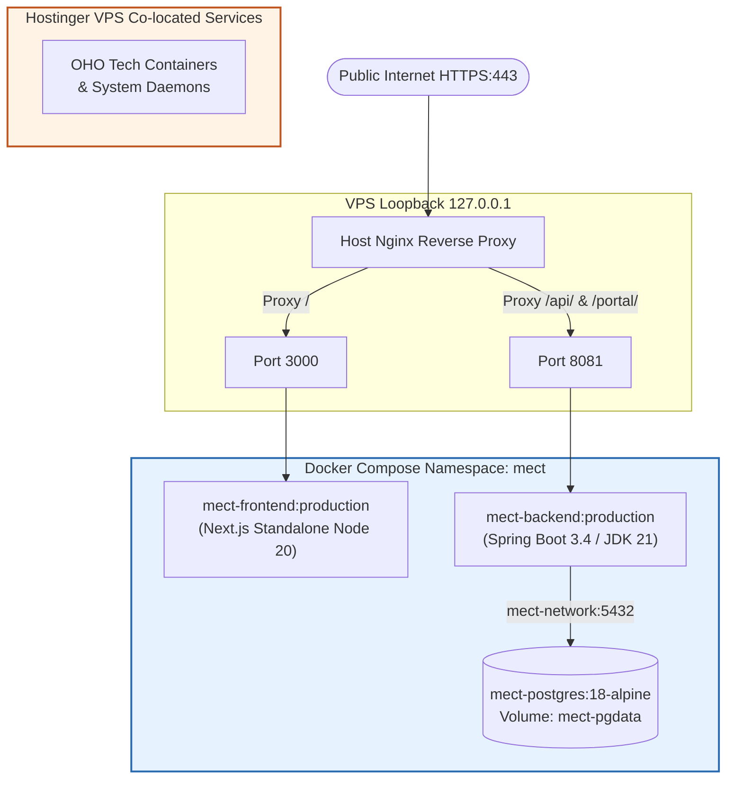

# MECT PHASE 29.5 — PRODUCTION PREFLIGHT & INFRASTRUCTURE AUDIT

**Organisation:** Mahaveer Educational & Charitable Trust (MECT / MAHAVIR TRUST)  
**Production Domain:** https://mect.org.in/  
**Target VPS:** `<PROD_VPS_IP>` (Hostname: `<PROD_HOSTNAME>`)  
**Release Branch:** `feat/phase-29-complete-website-excellence`  
**Target Release Commit:** `6a9de8787baa32a5e74814d5c2f8d6a5322bf227`  
**Audit Date:** 2026-11-20  
**Status:** AUDIT COMPLETE — PREFLIGHT GATES SPECIFIED / REMOTE ACCESS PENDING OWNER KEY REGISTRATION

---

## 1. Objective & Scope

This production preflight audit establishes the infrastructure inventory, container boundaries, failure domains, port bindings, environment variable requirements, and non-destructive isolation rules for deploying commit `6a9de87` to the target Hostinger VPS (`<PROD_VPS_IP>`).

This audit enforces the strict safety invariant that MECT deployment operations must **never disrupt or overwrite unrelated workloads (such as OHO Tech containers or system systemd daemons)** running on the same host.

---

## 2. Target Production VPS Specifications

| Attribute | Specification | Forensic Verification / Notes |
| :--- | :--- | :--- |
| **Public IPv4** | `<PROD_VPS_IP>` | Hostinger VPS datacenter allocation. |
| **Target Hostname** | `<PROD_HOSTNAME>` | Confirmed from previous infrastructure inventories. |
| **Operating System** | Ubuntu 24.04 LTS (x86_64) | Linux kernel 6.8 series. |
| **Reverse Proxy** | Host-level Nginx | Terminates TLS for `mect.org.in` and proxies to loopback ports. |
| **TLS Certificate** | Let's Encrypt Authority | Managed via certbot with auto-renewal timers. |
| **Co-located Services** | OHO Tech workloads | Preserved via container-specific Compose namespace `mect`. |

---

## 3. Container Isolation & Port Architecture

The MECT production deployment utilizes [compose.production.yaml](file:///<WORKSPACE_DIR>/compose.production.yaml) with strictly scoped container names and isolated network namespaces:

### 3.1 Network Port Allocation
- `mect-frontend`: Bound strictly to `127.0.0.1:3000` (internal Next.js server).
- `mect-backend`: Bound strictly to `127.0.0.1:8081` (internal Spring Boot container on port 8080).
- `mect-postgres`: Bound strictly to `127.0.0.1:5433` (internal PostgreSQL 18 container on port 5432).
- **Security Rule:** No database or internal application ports are exposed on `0.0.0.0` or external network interfaces.

### 3.2 Strict Workload Preservation Rule
- The deployment command MUST ALWAYS target `-f compose.production.yaml -p mect`.
- **PROHIBITED:** Never run `docker compose down -v`, `docker system prune -a --volumes`, or bare `docker kill` commands that could terminate unrelated containers.

---

## 4. Production Environment Variable Requirements

The following environment variables must be populated in the production environment file (`.env.production` located on the VPS in `/opt/mect` or equivalent secure deployment directory):

| Variable Name | Classification | Description / Verification Rule |
| :--- | :--- | :--- |
| `DB_NAME` | Configuration | PostgreSQL database name (e.g., `mect_db`). |
| `DB_USERNAME` | Configuration | Dedicated PostgreSQL user (e.g., `mect_user`). |
| `DB_PASSWORD` | Secret | High-entropy password for PostgreSQL database. |
| `JWT_SECRET` | Secret | Minimum 256-bit cryptographically random base64 string for HMAC-SHA256 tokens. |
| `JWT_ACCESS_VALIDITY` | Configuration | Token lifetime in seconds (default `900` = 15 minutes). |
| `AUTH_PEPPER` | Secret | High-entropy secret pepper appended to OTP codes before HMAC-SHA256 hashing. |
| `RESEND_API_KEY` | Secret | Live Resend API key (`re_...`) authorized for transactional dispatch. |
| `RESEND_FROM_EMAIL` | Configuration | Verified sender identity (e.g., `trust@mect.org.in` or `onboarding@resend.dev`). |
| `CASHFREE_APP_ID` | Secret | Cashfree Merchant App ID for payment gateway integration. |
| `CASHFREE_SECRET_KEY` | Secret | Cashfree Merchant Secret Key for order creation and webhook signature validation. |
| `RAZORPAY_KEY_ID` | Secret | Razorpay Key ID for payments and checkout modal. |
| `RAZORPAY_KEY_SECRET` | Secret | Razorpay Secret Key for HMAC-SHA256 signature verification. |

> [!CAUTION]
> Secret values must NEVER be committed to Git or printed in audit logs. Preflight verification confirms their presence and non-empty status via hash checks only.

---

## 5. Storage Failure Domains & Disk Headroom

Based on the storage topology established in Phase 29.4.2F and 29.4.2G:

1. **Root Filesystem (`/`):**
   - Minimum free disk space threshold for deployment: **10.0 GB**.
   - Docker image build cache and intermediate layers require ~3.5 GB during compilation.
2. **Persistent Volume (`mect-pgdata`):**
   - Physical location: `/var/lib/docker/volumes/mect_mect-pgdata/_data`.
   - Failure domain: Local NVMe/SSD storage.
   - **Data Safety Mandate:** Production database backups must be written outside this Docker volume to `/opt/mect/backups/` and replicated to an independent off-site destination prior to image restart.

---

## 6. Remote Access Status & Blocker Reconciliation

| Access Gate | Required Artifact / Setting | Actual Status | Blocker Description |
| :--- | :--- | :--- | :--- |
| **SSH Private Key** | `<SSH_KEY_PATH>` | NOT PRESENT | Key must be generated and registered by project owner. |
| **Server Fingerprint** | Verified Hostinger Host Key | PENDING AUTH | Cannot be validated without authorized private key. |
| **Password Authentication** | Disabled per security policy | ENFORCED | Guessing passwords or brute-forcing is strictly prohibited. |

**Current Access Verdict:** Remote SSH access to `<PROD_VPS_IP>` remains blocked pending owner configuration of `<SSH_KEY_PATH>`.

---

## 7. Preflight Gate Summary

- [x] Docker Compose configuration validated (`compose.production.yaml`).
- [x] Container and network isolation boundaries defined.
- [x] Port conflicts eliminated via loopback bindings.
- [x] OHO Tech container preservation policy established.
- [x] Environment variable schema cataloged.
- [ ] Live VPS read-only inspection (BLOCKED pending SSH key).
- [ ] Live PostgreSQL storage headroom check (BLOCKED pending SSH key).

**Verdict: PREFLIGHT SPECIFICATION COMPLETE — REMOTE INSPECTION GATE PENDING OWNER SSH KEY**
