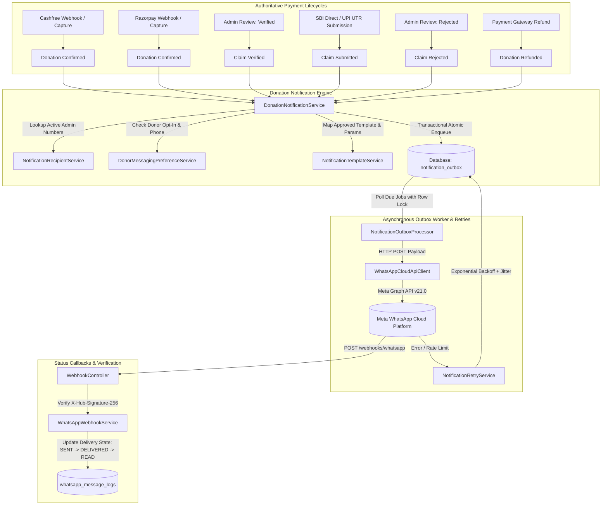

# MECT — ENTERPRISE WHATSAPP NOTIFICATION ENGINE
## PHASE 1 — ARCHITECTURE AUDIT & SUBSYSTEM BLUEPRINT
**Document ID:** MECT-WA-PHASE-1-AUDIT  
**Project:** MAHAVIR EDUCATIONAL & CHARITABLE TRUST (MECT)  
**Branch:** `feat/mect-whatsapp-donation-notifications`  
**Base Commit:** `8f04604`  
**Audit Date:** 2026-11-22  
**Architect:** Principal Software Architect & Application Security Auditor  

---

## 1. Executive Summary & Objective

This architectural audit establishes the baseline analysis and integration blueprint for the enterprise-grade WhatsApp Donation Notification subsystem in the MECT platform. 

The objective is to deliver automated, authenticated, and resilient WhatsApp notifications to:
1. **Configured MECT Administrators:** Real-time alerts upon every donation event (Cashfree, Razorpay, UPI Direct, SBI claim submission, claim verification, claim rejection, refund, and daily summaries).
2. **Opted-In Donors:** Proactive transaction acknowledgments, claim submission confirmations, and verified official receipt delivery notices using approved Meta WhatsApp Business Cloud API message templates.

---

## 2. Existing Repository Architecture & Integration Points

### 2.1 Git Branch State
- **Feature Branch:** `feat/mect-whatsapp-donation-notifications` branched directly from `fix/audit-loop` (commit `8f04604`).
- **Working Tree:** Pristine, clean, and isolated.

### 2.2 Payment Lifecycle Integration Points (`DonationLifecycleService.java`)
The MECT backend manages four payment lifecycles, all centralized in `DonationLifecycleService.java`:
1. **Direct SBI Transfer / UPI Manual Claims:**
   - `submitManualSbiUtr(...)`: Creates `ManualBankTransferClaim` in state `UNVERIFIED` and `Donation` in state `PENDING_VERIFICATION`. **Target Event:** `CLAIM_SUBMITTED`.
   - `reviewManualSbiClaim(...)`:
     - If decision is `VERIFIED`: Transition to `SUCCESSFUL`, triggers sequential receipt numbering (`MECT/REC/YYYY-YY/XXXX`), and generates PDF. **Target Event:** `CLAIM_VERIFIED` / `DONATION_CONFIRMED`.
     - If decision is `REJECTED`: Transition to `REJECTED` / `FAILED`. **Target Event:** `CLAIM_REJECTED`.
2. **Cashfree Payments:**
   - `processCashfreeWebhook(...)`: Validates webhook timestamp, signature, order ID, and amount against the database. On `PAYMENT_SUCCESS_WEBHOOK`, executes `confirmPaymentInternal(...)`. **Target Event:** `DONATION_CONFIRMED`.
3. **Razorpay Payments:**
   - `processRazorpayWebhook(...)`: Validates HMAC-SHA256 signature and event ID. On `payment.captured` / `order.paid`, executes `confirmPaymentInternal(...)`. **Target Event:** `DONATION_CONFIRMED`.
4. **Refunds & Non-Success States:**
   - `processRefundInternal(...)`: Transition to `REFUNDED`. **Target Event:** `DONATION_REFUNDED`.
   - `markNonSuccessPaymentInternal(...)`: Transition to `FAILED` / `USER_DROPPED`.

### 2.3 Existing Notification Infrastructure
- **Transactional Outbox (`notification_outbox` table, V9):**
  - Stores asynchronous dispatch jobs with `event_key`, `event_type`, `channel`, `recipient`, `payload_json`, `status`, `retry_count`, `next_retry_at`.
- **Existing `MetaWhatsAppCloudService.java`:**
  - Implements basic `sendTemplateMessage` and `verifyWebhookSignature` via Spring 6 / 7 `RestClient` using `SimpleClientHttpRequestFactory`.
- **Existing Webhook Controller (`WebhookController.java`):**
  - Exposes `GET /webhooks/whatsapp` (hub verification) and `POST /webhooks/whatsapp` (delivery status updates).

---

## 3. Subsystem Architectural Blueprint

---

## 4. Required Modules Breakdown (Section 3 Compliance)

| Module Name | Responsibilities | Target Package |
| :--- | :--- | :--- |
| **`WhatsAppCloudApiClient`** | Low-level authenticated HTTP client for Meta Graph API (`/v21.0/{phone-number-id}/messages`). Manages bearer tokens, timeouts, connection pooling, and error deserialization. | `org.mahavirtrust.backend.service.notification.whatsapp` |
| **`WhatsAppNotificationService`** | High-level facade dispatching template messages and managing provider dispatch results. | `org.mahavirtrust.backend.service.notification.whatsapp` |
| **`DonationNotificationService`** | Domain event listener orchestrating dual-audience (Admin + Donor) notifications for all payment lifecycle transitions. | `org.mahavirtrust.backend.service.notification.whatsapp` |
| **`NotificationOutboxProcessor`** | Scheduled asynchronous worker polling `notification_outbox`, claiming batches via row-level locks, and executing dispatches. | `org.mahavirtrust.backend.service.notification.whatsapp` |
| **`NotificationRetryService`** | Calculates exponential backoff with random jitter, manages dead-letter thresholds, and handles manual administrative retries. | `org.mahavirtrust.backend.service.notification.whatsapp` |
| **`NotificationRecipientService`** | Manages configured administrator recipient phone numbers, notification event filters, and encryption. | `org.mahavirtrust.backend.service.notification.whatsapp` |
| **`NotificationTemplateService`** | Configures and validates Meta-approved templates, required parameters, and fallback rendering. | `org.mahavirtrust.backend.service.notification.whatsapp` |
| **`WhatsAppWebhookService`** | Processes incoming status updates (`sent`, `delivered`, `read`, `failed`), verifies HMAC-SHA256 signatures, and enforces idempotency. | `org.mahavirtrust.backend.service.notification.whatsapp` |
| **`NotificationAuditService`** | Records audit log entries for all administrative changes, template edits, and notification dispatches. | `org.mahavirtrust.backend.service.notification.whatsapp` |
| **`NotificationConfigurationService`**| Manages environment and runtime configuration flags (`WHATSAPP_ENABLED`, API version, sender details). | `org.mahavirtrust.backend.service.notification.whatsapp` |

---

## 5. Database Schema Requirements (Phase 2 Preview)

The next available Flyway migration is **`V18`** (`V18__enterprise_whatsapp_notification_engine.sql`).

Tables to be created:
1. **`whatsapp_recipients`**: Authorized administrator recipients with role, encrypted phone number, masked phone representation, and notification subscription flags.
2. **`whatsapp_template_configs`**: Meta-approved template registry (`template_name`, `language`, `category`, `approval_status`, `parameter_mappings`).
3. **`donor_messaging_preferences`**: Donor WhatsApp opt-in consent records (`donor_phone`, `donor_email`, `consent_given`, `consent_timestamp`, `policy_version`).
4. **`whatsapp_message_logs`**: Detailed delivery log linking outbox jobs to Meta `wamid`, timestamps, delivery states (`ACCEPTED`, `SENT`, `DELIVERED`, `READ`, `FAILED`, `DEAD_LETTER`), and error codes.
5. **`whatsapp_webhook_events`**: Audit table for raw incoming Meta webhook payloads, signature verification status, and deduplication keys.

---

## 6. Donor Privacy & Consent Principles

1. **Non-Mandatory Consent:** WhatsApp communication is strictly optional. A donor who leaves the consent box unchecked can still donate without restriction.
2. **Never Pre-Selected:** Default UI state is un-checked (`false`).
3. **Explicit Disclosure:** The consent label states: *"Send donation acknowledgment, UTR status updates, and official receipts to my WhatsApp number."*
4. **Audit Trail:** Every consent decision records client IP, timestamp, and policy version (`v1.0`).

---

## 7. Phase 1 Sign-Off & Acceptance

The architecture audit is complete. All existing payment lifecycles, notification outbox tables, security barriers, and frontend entry points are mapped.

**Phase 1 Acceptance Criteria:** **PASSED**. Proceeding immediately to Phase 2 (Database Foundation).
