# MECT PRODUCTION DEPLOYMENT CHECKLIST & OPERATIONAL RUNBOOK

**Organisation:** Mahaveer Educational & Charitable Trust (MECT)  
**Repository:** `Himansu-Nayak/MECT`  
**Compose Specification:** `compose.production.yaml`  
**Domain:** `https://mect.org.in/`  
**Staging Target:** Staging container or subdomain prior to production switch  
**Document Classification:** Confidential — Fiduciary Operations Runbook  
**Last Revised:** 2026-11-20

---

## 1. Architectural Topology & Service Specification

Sourced directly from `compose.production.yaml`. All services run within the isolated bridge network `mect-network` and bind exclusively to the host loopback (`127.0.0.1`) to prevent public network exposure.

| Service Name | Container Name | Image Specification | Loopback Port | Persistent Volumes / Healthcheck |
| :--- | :--- | :--- | :--- | :--- |
| **`mect-postgres`** | `mect-postgres` | `postgres:18-alpine` | `127.0.0.1:5433:5432` | Volume: `mect-pgdata`<br>Healthcheck: `pg_isready -U ${DB_USERNAME:-mect_user} -d ${DB_NAME:-mect_db}` |
| **`mect-backend`** | `mect-backend` | `mect-backend:production` | `127.0.0.1:8081:8080` | Volumes: `mect-media`, `mect-receipts`<br>Healthcheck: `GET http://127.0.0.1:8080/api/v1/actuator/health` |
| **`mect-frontend`** | `mect-frontend` | `mect-frontend:production` | `127.0.0.1:3001:3000` | Healthcheck: `GET http://127.0.0.1:3000/api/ai/health` |

Host-level reverse proxy (Nginx) terminates TLS for `https://mect.org.in/` and forwards traffic:
- Web routes & assets: `http://127.0.0.1:3001`
- REST API routes (`/api/v1/*`): `http://127.0.0.1:8081`

### Reverse Proxy Trusted Header Configuration (Nginx):
```nginx
proxy_set_header X-Forwarded-For $proxy_add_x_forwarded_for;
proxy_set_header X-Real-IP $remote_addr;
proxy_set_header Host $host;
proxy_set_header X-Forwarded-Proto $scheme;
```

---

## 2. Infrastructure Placeholders & Variables

Never assume root credentials, specific host IPs, or arbitrary filesystem paths. All operations must use the following placeholders:

- `<VPS_HOST>`: Production server hostname or private IP (e.g., managed via SSH config).
- `<DEPLOY_USER>`: Dedicated non-root operator account with docker permissions (e.g., `mect` or `deploy`).
- `<APP_DIR>`: Root deployment directory on the VPS (e.g., `/home/<DEPLOY_USER>/app` or `/opt/mect`).
- `<BACKUP_DIR>`: Secure failure-domain directory for database dumps (permissions `0700`).
- `${DB_NAME}`: PostgreSQL database name (default: `mect_db`).
- `${DB_USERNAME}`: PostgreSQL user (default: `mect_user`).

---

## 3. Pre-Deployment Safety Gates (MUST PASS BEFORE DEPLOY)

Every release candidate must pass all five gates prior to touching production:

- [ ] **Gate 1: Physical Passbook Reconciliation (CRITICAL)**
  - Physical inspection of the official State Bank of India passbook/chequebook confirming:
    - Account: `33341302498`
    - IFSC: `SBIN0001701`
    - Branch: **Rajendra College Square, Bolangir**
    - UPI ID: `86971610172@sbi`
    - Beneficiary: **MAHAVEER EDUCATIONAL & CHARITABLE TRUST**
- [ ] **Gate 2: Database Bank Credentials Pre-Deploy SQL Audit**
  - Execute read-only query on production database to compare stored values against `src/config/org.ts`:
    ```sql
    docker exec -i mect-postgres psql -U ${DB_USERNAME:-mect_user} -d ${DB_NAME:-mect_db} -c \
    "SELECT id, sbi_bank_name, sbi_account_name, sbi_account_number, sbi_ifsc, sbi_branch, sbi_upi_id FROM payment_configurations WHERE id = 1;"
    ```
  - Expected values matching `src/config/org.ts`:
    - `sbi_bank_name`: `'State Bank of India'`
    - `sbi_account_name`: `'MAHAVEER EDUCATIONAL & CHARITABLE TRUST'`
    - `sbi_account_number`: `'33341302498'`
    - `sbi_ifsc`: `'SBIN0001701'`
    - `sbi_branch`: `'Rajendra College Square, Bolangir, Odisha'`
    - `sbi_upi_id`: `'86971610172@sbi'`
  - *If stored DB values differ:* Reconcile and update table before deploying new frontend image.
- [ ] **Gate 3: GitHub Pull Request & Clean Git State**
  - All changes merged to release branch via reviewed Pull Request on GitHub.
  - Working tree clean, zero uncommitted modifications.
  - Git commit signature verified.
- [ ] **Gate 4: Automated Quality, Accessibility & Multi-Run Performance Gate**
  - `npm run build` passes with zero errors.
  - `npm run typecheck` (`tsc --noEmit`) passes with zero errors.
  - `npm run check:confirm` passes with zero unresolved confirmation blockers.
  - `npm run verify` passes: 0 broken links, 0 broken anchors, 0 serious/critical axe violations.
  - `npm run verify:perf` passes: 3-run Lighthouse median Performance >= 90, LCP <= 2.5s, CLS <= 0.1 across all 6 core pages.
- [ ] **Gate 5: Co-Hosted Workload Isolation**
  - Verify that unrelated processes or containers on `<VPS_HOST>` (e.g., co-hosted websites or client workloads) share no docker volumes, ports, or networks with `mect`.

---

## 4. GitHub Pull Request Workflow

```mermaid
flowchart LR
    Feature["fix/audit-loop\n(Local Branch)"] -->|Push| PR["GitHub PR\n(Himansu-Nayak/MECT)"]
    PR -->|CI Checks| CI["Build, Typecheck\n& Verify Scripts"]
    CI -->|Pass| Review["Peer & Owner Review\n(Documentary Verification)"]
    Review -->|Squash & Merge| Main["main Branch\n(Release Baseline)"]
    Main -->|Staging Deploy| Staging["Staging Validation\n(Subdomain / Port 3002)"]
    Staging -->|Verify Pass| Prod["Production Deploy\n(Port 3001)"]
```



---

## 5. Step-by-Step Production Execution Runbook

### Step 1: Secure Authentication
```bash
ssh <DEPLOY_USER>@<VPS_HOST>
```

### Step 2: Create Pre-Deployment Failure-Domain Database Backup
```bash
mkdir -p <BACKUP_DIR>
chmod 700 <BACKUP_DIR>

# Execute binary custom-format dump
docker exec mect-postgres pg_dump -U ${DB_USERNAME:-mect_user} -d ${DB_NAME:-mect_db} -Fc > <BACKUP_DIR>/mect_db_pre_deploy_$(date +%Y%m%d_%H%M%S).dump

# Verify dump file size and table of contents
ls -lh <BACKUP_DIR>/mect_db_pre_deploy_*.dump
pg_restore -l <BACKUP_DIR>/mect_db_pre_deploy_*.dump | head -n 15
```

### Step 3: Run Database Pre-Deploy Bank Comparison Query
```bash
docker exec -i mect-postgres psql -U ${DB_USERNAME:-mect_user} -d ${DB_NAME:-mect_db} -c \
"SELECT id, sbi_account_number, sbi_ifsc, sbi_upi_id FROM payment_configurations WHERE id = 1;"
```
Confirm: `33341302498` / `SBIN0001701` / `86971610172@sbi`.

### Step 4: Synchronize Repository
```bash
cd <APP_DIR>
git fetch origin main
git checkout main
git pull origin main

# Assert deployed commit matches expected release SHA
git rev-parse HEAD
```

### Step 5: Staging Deployment & Verification (MANDATORY BEFORE PROD REPLACEMENT)
Before replacing the live production frontend container:
1. Deploy to a staging port or container (e.g. `mect-frontend-staging` on port `3002`):
   ```bash
   docker build -t mect-frontend:staging .
   docker run -d --name mect-frontend-staging --network mect-network -p 127.0.0.1:3002:3000 --env-file .env mect-frontend:staging
   ```
2. Run rendered verification against staging URL:
   ```bash
   TEST_BASE_URL=http://127.0.0.1:3002 npm run verify
   ```
3. **MANDATORY Real Backend End-to-End Submission & Database Verification:**
   *(Required because local development workstation does not run the Docker daemon; must be proven in staging container environment)*:
   
   **A. Verify Donation Claim Intake -> DB Row & Admin Endpoint:**
   - Submit test claim to staging intake proxy:
     ```bash
     curl -s -X POST http://127.0.0.1:3002/api/donations/claim \
       -H "Content-Type: application/json" \
       -d '{"donorName":"Staging Verification","donorEmail":"staging@mect.org.in","donorPhone":"9437123616","amount":500,"utrReference":"STAGINGSBI123456","transferDate":"2026-11-20","programmeCode":"GENERAL"}'
     ```
   - Expected response: HTTP 200 with JSON payload `{"success": true, "claimReference": "MECT-...", "status": "UNVERIFIED"}`.
   - Assert database row exists in `manual_bank_transfer_claims` with matching reference:
     ```bash
     docker exec -i mect-postgres psql -U ${DB_USERNAME:-mect_user} -d ${DB_NAME:-mect_db} -c \
       "SELECT id, claim_reference, utr_normalized, claimed_amount, status, created_at FROM manual_bank_transfer_claims WHERE utr_normalized = 'STAGINGSBI123456';"
     ```
   - Assert visible through admin claims endpoint:
     ```bash
     curl -s -H "Authorization: Bearer <ADMIN_TOKEN>" http://127.0.0.1:8081/api/v1/admin/donations/claims | grep STAGINGSBI123456
     ```
   
   **B. Verify Contact Form Intake -> DB Row & Admin Endpoint:**
   - Submit test inquiry to staging intake proxy:
     ```bash
     curl -s -X POST http://127.0.0.1:3002/api/contact \
       -H "Content-Type: application/json" \
       -d '{"name":"Staging Verification","email":"staging@mect.org.in","phone":"9437123616","category":"General","message":"Staging end-to-end inquiry verification"}'
     ```
   - Expected response: HTTP 201 with JSON payload `{"success": true, "referenceId": "MECT-INQ-..."}`.
   - Assert database row exists in `public_inquiries` with matching ticket number:
     ```bash
     docker exec -i mect-postgres psql -U ${DB_USERNAME:-mect_user} -d ${DB_NAME:-mect_db} -c \
       "SELECT id, ticket_number, full_name, email, status, created_at FROM public_inquiries WHERE email = 'staging@mect.org.in' ORDER BY id DESC LIMIT 1;"
     ```
   - Assert reference number returned matches the ticket number in the database row.

4. Only upon 100% pass of all checks above, proceed to Step 6. Stop and remove staging container:
   ```bash
   docker stop mect-frontend-staging && docker rm mect-frontend-staging
   ```

### Step 6: Deploy Production Services
```bash
# Build production images cleanly
docker compose -f compose.production.yaml build

# Deploy containers in background mode (no --remove-orphans to protect unrelated host workloads)
docker compose -f compose.production.yaml up -d
```

### Step 7: Post-Deployment Smoke Verification
```bash
# 1. Check container health states
docker compose -f compose.production.yaml ps

# 2. Check internal loopback endpoints
curl -fsS http://127.0.0.1:3001/api/ai/health
curl -fsS http://127.0.0.1:8081/api/v1/actuator/health

# 3. Check public HTTPS response
curl -I https://mect.org.in/
curl -I https://mect.org.in/donate
curl -I https://mect.org.in/programmes
```

### Step 8: Production Google PageSpeed Insights Audit
Run Google PageSpeed Insights (or Chrome DevTools Lighthouse with real network profile) against live production URLs:
- `https://mect.org.in/`
- `https://mect.org.in/programmes`
- `https://mect.org.in/donate`

Verify LCP < 2.5s and CLS < 0.1 over real CDN/TLS network.

---

## 6. Immediate Rollback Plan

If any post-deployment smoke check fails, or if an unexpected data anomaly is detected:

1. **Revert Containers:**
   ```bash
   cd <APP_DIR>
   git checkout <PREVIOUS_COMMIT_SHA>
   docker compose -f compose.production.yaml up -d --build
   ```
2. **Restore Database (if Flyway or schema migration corrupted state):**
   ```bash
   docker exec -i mect-postgres pg_restore -U ${DB_USERNAME:-mect_user} -d ${DB_NAME:-mect_db} --clean --if-exists < <BACKUP_DIR>/<BACKUP_FILE>.dump
   ```
3. **Verify Restored State:**
   ```bash
   curl -fsS http://127.0.0.1:3001/api/ai/health
   curl -I https://mect.org.in/
   ```
