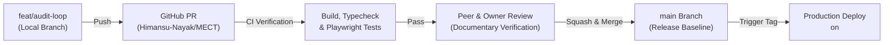

# MECT PRODUCTION DEPLOYMENT CHECKLIST & OPERATIONAL RUNBOOK

**Organisation:** Mahaveer Educational & Charitable Trust (MECT)  
**Repository:** `Himansu-Nayak/MECT`  
**Compose Specification:** `compose.production.yaml`  
**Domain:** `https://mect.org.in/`  
**Document Classification:** Confidential — Fiduciary Operations Runbook  
**Last Revised:** 2026-11-20

---

## 1. Architectural Topology & Service Specification

Sourced directly from `compose.production.yaml`. All services run within the isolated bridge network `mect-network` and bind exclusively to the host loopback (`127.0.0.1`) to prevent public network exposure.

| Service Name | Container Name | Image Specification | Loopback Port | Persistent Volumes / Healthcheck |
| :--- | :--- | :--- | :--- | :--- |
| **`mect-postgres`** | `mect-postgres` | `postgres:18-alpine` | `127.0.0.1:5433:5432` | Volume: `mect-pgdata`<br>Healthcheck: `pg_isready -U ${DB_USERNAME:-mect_user} -d ${DB_NAME:-mect_db}` |
| **`mect-backend`** | `mect-backend` | `mect-backend:production` | `127.0.0.1:8081:8080` | Volumes: `mect-media`, `mect-receipts`<br>Healthcheck: `GET http://127.0.0.1:8080/api/v1/actuator/health` |
| **`mect-frontend`** | `mect-frontend` | `mect-frontend:production` | `127.0.0.1:3001:3000` | Healthcheck: `GET http://127.0.0.1:3000/api/ai/health` |

Host-level reverse proxy (Nginx) terminates TLS for `https://mect.org.in/` and forwards traffic:
- Web routes & assets: `http://127.0.0.1:3001`
- REST API routes (`/api/v1/*`): `http://127.0.0.1:8081`

---

## 2. Infrastructure Placeholders & Variables

Never assume root credentials, specific host IPs, or arbitrary filesystem paths. All operations must use the following placeholders:

- `<VPS_HOST>`: Production server hostname or private IP (e.g., managed via SSH config).
- `<DEPLOY_USER>`: Dedicated non-root operator account with docker permissions (e.g., `mect` or `deploy`).
- `<APP_DIR>`: Root deployment directory on the VPS (e.g., `/home/<DEPLOY_USER>/app` or `/opt/mect`).
- `<BACKUP_DIR>`: Secure failure-domain directory for database dumps (permissions `0700`).
- `${DB_NAME}`: PostgreSQL database name (default: `mect_db`).
- `${DB_USERNAME}`: PostgreSQL user (default: `mect_user`).

---

## 3. Pre-Deployment Safety Gates (MUST PASS BEFORE DEPLOY)

Every release candidate must pass all four gates prior to touching production:

- [ ] **Gate 1: Physical Passbook Reconciliation (CRITICAL)**
  - Physical inspection of the official State Bank of India passbook/chequebook confirming:
    - Account: `33341302498`
    - IFSC: `SBIN0001701`
    - Branch: **Rajendra College Square, Bolangir**
    - UPI ID: `86971610172@sbi`
    - Beneficiary: **MAHAVEER EDUCATIONAL & CHARITABLE TRUST**
- [ ] **Gate 2: GitHub Pull Request & Clean Git State**
  - All changes merged to release branch via reviewed Pull Request on GitHub.
  - Working tree clean, zero uncommitted modifications.
  - Git commit signature verified.
- [ ] **Gate 3: Automated Quality & Accessibility Gate**
  - `npm run build` passes with zero errors.
  - `npm run typecheck` (`tsc --noEmit`) passes with zero errors.
  - `npm run check:confirm` passes with zero unresolved confirmation blockers.
  - `npm run verify` passes: 0 broken links, 0 broken anchors, 0 serious/critical axe violations.
- [ ] **Gate 4: Co-Hosted Workload Isolation**
  - Verify that unrelated processes or containers on `<VPS_HOST>` (e.g., co-hosted websites or client workloads) share no docker volumes, ports, or networks with `mect`.

---

## 4. GitHub Pull Request Workflow



1. **Open Pull Request:**
   ```bash
   git push origin fix/audit-loop
   # Open PR on GitHub: Himansu-Nayak/MECT
   ```
2. **Review & CI Checks:**
   - Verify GitHub Actions workflow completes successfully.
   - Ensure `OWNER_DECISIONS.md` has no unreviewed factual blockers.
3. **Merge:**
   - Squash and merge PR into `main`. Note the merge commit SHA.

---

## 5. Step-by-Step Production Execution Runbook

### Step 1: Secure Authentication
```bash
ssh <DEPLOY_USER>@<VPS_HOST>
```

### Step 2: Create Pre-Deployment Failure-Domain Database Backup
```bash
mkdir -p <BACKUP_DIR>
chmod 700 <BACKUP_DIR>

# Execute binary custom-format dump
docker exec mect-postgres pg_dump -U ${DB_USERNAME:-mect_user} -d ${DB_NAME:-mect_db} -Fc > <BACKUP_DIR>/mect_db_pre_deploy_$(date +%Y%m%d_%H%M%S).dump

# Verify dump file size and table of contents
ls -lh <BACKUP_DIR>/mect_db_pre_deploy_*.dump
pg_restore -l <BACKUP_DIR>/mect_db_pre_deploy_*.dump | head -n 15
```

### Step 3: Synchronize Repository
```bash
cd <APP_DIR>
git fetch origin main
git checkout main
git pull origin main

# Assert deployed commit matches expected release SHA
git rev-parse HEAD
```

### Step 4: Build and Deploy Services
```bash
# Build production images cleanly
docker compose -f compose.production.yaml build

# Deploy containers with zero-orphan hygiene
docker compose -f compose.production.yaml up -d --remove-orphans
```

### Step 5: Post-Deployment Smoke Verification
```bash
# 1. Check container health states
docker compose -f compose.production.yaml ps

# 2. Check internal loopback endpoints
curl -fsS http://127.0.0.1:3001/api/ai/health
curl -fsS http://127.0.0.1:8081/api/v1/actuator/health

# 3. Check public HTTPS response
curl -I https://mect.org.in/
curl -I https://mect.org.in/donate
curl -I https://mect.org.in/programmes
```

---

## 6. Immediate Rollback Plan

If any post-deployment smoke check fails, or if an unexpected data anomaly is detected:

1. **Revert Containers:**
   ```bash
   cd <APP_DIR>
   git checkout <PREVIOUS_COMMIT_SHA>
   docker compose -f compose.production.yaml up -d --build
   ```
2. **Restore Database (if Flyway or schema migration corrupted state):**
   ```bash
   docker exec -i mect-postgres pg_restore -U ${DB_USERNAME:-mect_user} -d ${DB_NAME:-mect_db} --clean --if-exists < <BACKUP_DIR>/<BACKUP_FILE>.dump
   ```
3. **Verify Restored State:**
   ```bash
   curl -fsS http://127.0.0.1:3001/api/ai/health
   curl -I https://mect.org.in/
   ```
