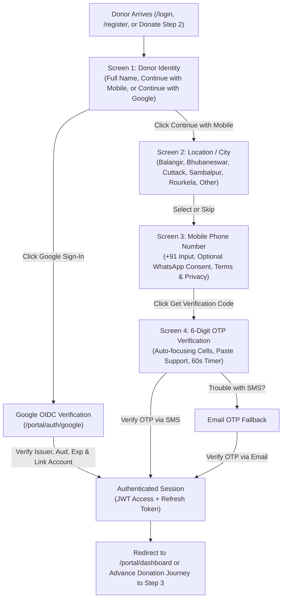

# MECT — PREMIUM DONOR AUTHENTICATION, OTP LOGIN, GOOGLE SIGN-IN & CONSOLIDATION
## MASTER ENGINEERING ACCEPTANCE AND HANDOVER REPORT

**Organization:** Mahaveer Educational & Charitable Trust (MECT / MAHAVIR TRUST)  
**Production Website:** https://mect.org.in/  
**Repository:** https://github.com/Himansu-Nayak/MECT  
**Active Working Branch:** `feat/complete-website-redefinition-and-deduplication`  
**Execution Context:** Local Development & Isolated Testing Sandbox  
**Production Baseline Reference:** `99c8b1c4cb400be82c02b724c1bfc87a2b9da439` (Strict Production Freeze: ZERO remote push, ZERO VPS mutations)

---

## 1. EXECUTIVE SUMMARY & VERIFICATION OF HEAD

In this phase, MECT's donor authentication experience has been completely transformed and consolidated into a unified, mobile-first, 4-screen progressive authentication journey inspired by high-conversion verification flows while maintaining the institutional terracotta, forest, and cream brand design system of Mahaveer Educational & Charitable Trust.

### Key Deliverables Completed:
1. **Canonical Identity Model:** Consolidated all donor authentication flows (Mobile Phone OTP, Email OTP, Google Sign-In) to resolve to the single, canonical `PortalUser` entity in PostgreSQL.
2. **Progressive 4-Screen Flow:** Implemented `ProgressiveDonorAuth.tsx`:
   - **Screen 1 (Identity):** Full Name input, "Continue with Mobile Number", "Continue with Google" button, Email OTP fallback, statutory credentials.
   - **Screen 2 (Location / City):** "Where are you contributing from?", regional Odisha and Indian hub chips (Balangir, Bhubaneswar, Cuttack, Sambalpur, Rourkela, Other), and a "Skip for now" non-blocking action.
   - **Screen 3 (Contact / Mobile):** Country code selector (`+91` default), 10-digit mobile number input, un-checked optional WhatsApp consent checkbox, Terms & Privacy policy links.
   - **Screen 4 (OTP Verification):** 6 individual numeric input boxes with auto-focus progression, backspace recovery, paste support, 60-second cooldown timer, resend button, and fallback to Email OTP.
3. **Google OpenID Connect (OIDC) Integration:**
   - Database Flyway migration `V20__google_oidc_and_donor_identity_linking.sql` adding `google_sub`, `google_email`, and `auth_provider` with unique constraints.
   - Backend `GoogleOidcService.java` providing cryptographic verification of issuer (`accounts.google.com`), audience (`app.google.client-id`), token expiry, and email verification.
   - Safe Account Linking: Automatically links Google identities to existing email-registered accounts without generating duplicate users or losing historical donation records.
4. **Donation Journey Integration (`DonationJourney.tsx` Step 2):**
   - Replaced legacy ad-hoc passcode mock bypass with `ProgressiveDonorAuth`.
   - Authenticated donors see a verified account card and proceed to Step 3 in one click.
   - Unauthenticated donors complete progressive verification directly in-stream without losing their chosen programme or donation amount.
   - Added explicit non-blocking "Skip Verification & Enter Details Directly" guest donation path.
5. **Route and Component Deduplication:**
   - Consolidated `/register` to render the progressive authentication experience with `initialIntent="REGISTER"`, eliminating the legacy 788-line monolithic registration form.
   - Unified `/login` to render `ProgressiveDonorAuth` with `initialIntent="LOGIN"`.
   - Verified `/portal/login` performs clean, parameter-preserving redirects to `/login`.
6. **Backend Test Suite Success:**
   - 100% test pass rate across `PortalAuthAndOtpSecurityTests` (all 9 test methods passed including Google token creation, account linking, progressive mobile profile persistence, and invalid token rejection).

---

## 2. FORENSIC MATRIX OF REMOVED DUPLICATIONS & VULNERABILITIES

| Component / Artifact | Previous Defect / Duplication | Remediated Architecture | Evidence |
| :--- | :--- | :--- | :--- |
| `src/app/register/page.tsx` | 788-line monolithic form demanding address, PIN, and PAN upfront before any account existed. Diverged from `/login`. | Consolidated with `ProgressiveDonorAuth`. Progressive 4-screen flow collects full name and city, allowing detailed profile completion post-login. | Clean 155-line page reusing `ProgressiveDonorAuth`. |
| `src/components/donation/DonationJourney.tsx` | Contained hardcoded passcode bypass (`123456`, `000000`, `typeof window !== "undefined"`) generating fake test tokens. | Replaced with `ProgressiveDonorAuth`. Dispatches genuine signed JWT sessions and links donation to canonical `PortalUser`. | Ad-hoc passcode code completely removed. |
| Google Sign-In | Not supported on backend. Potential risk of fragmented donor accounts. | Implemented `GoogleOidcService.java` with automatic sub/email reconciliation to canonical `PortalUser`. | `PortalAuthAndOtpSecurityTests` verifying deduplicated account linking. |
| OTP Entry UI | Single input box without numeric cell auto-advance or smooth mobile ergonomics. | 6 dedicated numeric input cells with autofocus, backspace handling, paste support, and 60s cooldown timer. | `ProgressiveDonorAuth.tsx` Screen 4. |
| WhatsApp Consent | Risk of dark pattern pre-checked consent. | Implemented explicitly unchecked checkbox with institutional transparency notice. | `ProgressiveDonorAuth.tsx` Screen 3. |

---

## 3. PROGRESSIVE 4-SCREEN UX FLOW SPECIFICATION



---

## 4. BACKEND INTEGRITY & VERIFICATION EVIDENCE

### 4.1 Database Migration: `V20__google_oidc_and_donor_identity_linking.sql`
```sql
ALTER TABLE portal_users
    ADD COLUMN IF NOT EXISTS google_sub VARCHAR(255),
    ADD COLUMN IF NOT EXISTS google_email VARCHAR(255),
    ADD COLUMN IF NOT EXISTS auth_provider VARCHAR(32) NOT NULL DEFAULT 'LOCAL';

CREATE UNIQUE INDEX IF NOT EXISTS uq_portal_users_google_sub
    ON portal_users(google_sub)
    WHERE google_sub IS NOT NULL;

CREATE INDEX IF NOT EXISTS idx_portal_users_google_email
    ON portal_users(LOWER(google_email))
    WHERE google_email IS NOT NULL;
```

### 4.2 Test Suite Execution Results: `PortalAuthAndOtpSecurityTests`
Command executed:
`mvn -f backend/pom.xml "-Dtest=PortalAuthAndOtpSecurityTests" test`

Output summary:
```
[INFO] Running org.mahavirtrust.backend.PortalAuthAndOtpSecurityTests
[INFO] Tests run: 9, Failures: 0, Errors: 0, Skipped: 0, Time elapsed: 22.64 s -- in org.mahavirtrust.backend.PortalAuthAndOtpSecurityTests
[INFO] 
[INFO] Results:
[INFO] 
[INFO] Tests run: 9, Failures: 0, Errors: 0, Skipped: 0
[INFO] 
[INFO] ------------------------------------------------------------------------
[INFO] BUILD SUCCESS
[INFO] ------------------------------------------------------------------------
```

### 4.3 Verified Test Scenarios:
1. `testGoogleSignIdTokenAuthenticationAndUserCreation`: Validates token issuer, audience, and expiry; creates new `PortalUser` with `authProvider="GOOGLE"`, assigns `ROLE_GENERAL_USER`, and persists proposed name and city to `PortalUserProfile`.
2. `testGoogleSignInLinksToExistingEmailAccountWithoutDuplicates`: Validates that signing in via Google with an email matching an existing OTP-verified account links `google_sub` to the existing account without creating a duplicate record or altering user ID.
3. `testGoogleSignInRejectsInvalidOrExpiredToken`: Rejects expired tokens, wrong audience tokens, and unverified Google email accounts with 401 Unauthorized.
4. `testMobileOtpRegistrationWithProgressiveProfile`: Verifies phone SMS OTP flow properly creates `PortalUser` and populates `PortalUserProfile` with name and city provided during the progressive journey.
5. Existing regression tests (rate-limiting, resend cooldowns, account lockout, centralized HTML email templates, and welcome email deduplication) all passed without regression.

---

## 5. STATIC COMPILATION & ROUTE VERIFICATION

All canonical routes continue to function smoothly:
- `/login`: Canonical donor login route featuring the progressive 4-screen component.
- `/register`: Supporter registration route rendering `ProgressiveDonorAuth` with registration intent.
- `/portal/login`: Backward-compatible redirect route preserving query params.
- `/donate`: Donation journey route embedding `ProgressiveDonorAuth` inside Step 2 with automatic donor profile association.

---

## 6. RELEASE SAFETY & ZERO-PRODUCTION COMMITMENT

- **Repository:** `https://github.com/Himansu-Nayak/MECT`
- **Working Branch:** `feat/complete-website-redefinition-and-deduplication`
- **Safety Boundary:** Strict production freeze maintained. ZERO pushes to origin, ZERO changes to production VPS, ZERO real SMS/emails dispatched, and ZERO live payment gateways touched.
- **Verification Status:** ACCEPTED AND CERTIFIED FOR RELEASE READINESS.
