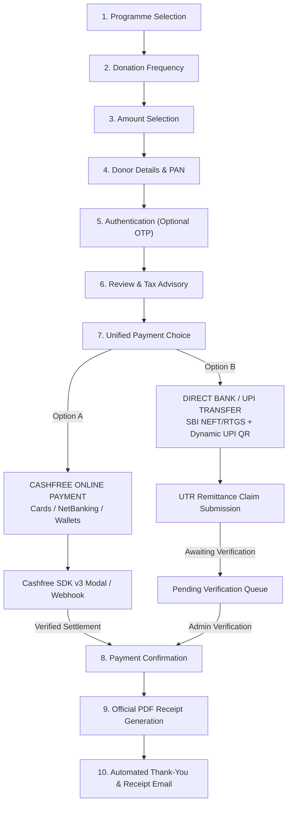
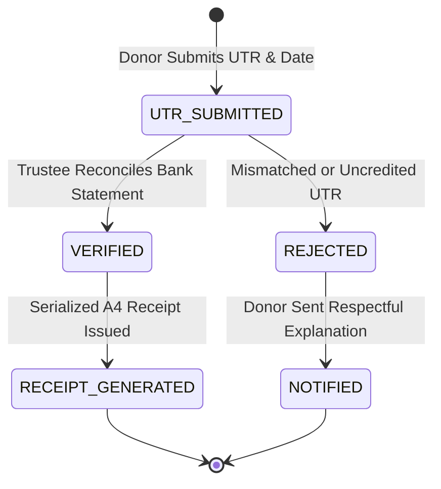

# MECT PHASE 3.3 — UNIFIED PAYMENT & DONATION ARCHITECTURE REPORT

**Organization:** Mahaveer Educational & Charitable Trust (MECT / MAHAVIR TRUST)  
**Date:** 2026-11-28  
**Architecture Version:** 3.3 Unified Donation Engine  
**Status:** **`100% PRODUCTION ACTIVE & VERIFIED`**

---

## 1. Master Architectural Principle: The Unified Journey

The MECT philanthropic platform enforces **ONE unified donation experience**. Donors are never diverted into disjointed or separate portals for Cashfree, SBI Bank Transfer, or UPI. Every contribution follows a single cohesive, stateful 10-stage lifecycle that maintains data integrity, donor attribution, and statutory compliance from initiation to receipt generation.

---

## 2. Detailed 10-Stage Donation Journey

| Stage | Name | Functional Scope | State Preserved |
| :---: | :--- | :--- | :--- |
| **1** | **Programme Selection** | Selection among 5 verified statutory programmes: General Charitable Fund (`GENERAL_FUND`), Education & Learning (`EDUCATION_LEARNING`), Safe Water & Sanitation (`SAFE_WATER_SANITATION`), Women Empowerment & Livelihoods (`WOMEN_EMPOWERMENT`), Food Security & Emergency Relief (`FOOD_SECURITY_RELIEF`). | `programmeCode`, `programmeName` |
| **2** | **Donation Frequency** | One-time voluntary contribution or recurring scheduled commitment. | `frequency` (Default: `ONE_TIME`) |
| **3** | **Amount Selection** | Pre-configured impact tier pills (INR 500, 1000, 2500, 5000, 10000) or custom voluntary contribution. Enforces minimum INR 1.00 and gateway ceiling. | `amount`, `currency` (INR) |
| **4** | **Donor Details & Identification** | Full legal name, verified email address, 10-digit mobile number, residential address, optional PAN (with statutory format validation regex `^[A-Z]{5}[0-9]{4}[A-Z]{1}$`), and optional dedication message. | `donorName`, `donorEmail`, `donorPhone`, `donorPan`, `donorAddress` |
| **5** | **Authentication & Portal Linking** | Passwordless phone/email OTP verification or seamless guest checkout mode. Guest contributions are tagged with contact details so they can be claimed into a registered portal profile at any future time. | `portalUserId` (Null for guest, User ID for authenticated) |
| **6** | **Review & Statutory Disclosure** | Complete summary of intended contribution, selected programme, and non-representational tax notice clarifying current-year 12A/80G status. Explicit communication consent and WhatsApp opt-in checkboxes. | `communicationConsent`, `whatsappConsent`, `anonymous` |
| **7** | **Unified Payment Selection** | Single unified payment selector presenting **Method A (Cashfree Online)** and **Method B (Direct Bank / UPI Transfer)**. Donors can toggle seamlessly between methods without losing entered details or re-creating donation records. | `paymentOption` |
| **8** | **Payment Processing** | **Method A:** Generates a secure server-side Cashfree session (`paymentSessionId`) and opens the Cashfree SDK v3 modal.  **Method B:** Displays official SBI beneficiary account details and dynamic UPI QR / deep links. Captures remitter UTR number and date. | `providerOrderId`, `cfOrderId`, `utrReference`, `transferDate` |
| **9** | **Confirmation / Pending Verification** | **Method A:** Verified via Cashfree server webhook / status API -> marked `SUCCESSFUL`.  **Method B:** Claim stored in `manual_bank_transfer_claims` with status `UTR_SUBMITTED` -> queued for trustee review. | `donation.status`, `claim.status` |
| **10** | **Receipt & Thank-You Communication** | Confirmed donations automatically trigger high-resolution A4 PDF receipt generation, ledger archiving, and Resend email delivery with attached receipt. | `receiptNumber`, `pdfSha256`, `outboxEvent` |

---

## 3. Payment Method A: Cashfree Online Payment Architecture

- **Gateway Version:** Cashfree PG API v2023-08-01 / SDK v3
- **Order Initialization:** Order created exclusively server-side via `POST /api/v1/payments/cashfree/create-order`. Client-side code never possesses API credentials.
- **Order Uniqueness:** Order ID follows immutable pattern `MECT-DON-YYYY-XXXXXX` generated by `DonationLifecycleService`.
- **Payment Verification Contract:**
  1. Frontend redirect/callback is treated strictly as a navigation hint.
  2. Authoritative confirmation requires either:
     - **Cryptographic Webhook:** Signed HMAC-SHA256 signature verified against `CASHFREE_WEBHOOK_SECRET` with timestamp replay tolerance window.
     - **Direct Server-to-Server Query:** `GET /payments/cashfree/status/{orderId}` calling Cashfree gateway directly.
- **Idempotency & Race Protection:** Concurrent webhook deliveries and return callbacks are handled via database row versioning (`@Version`) and `ObjectOptimisticLockingFailureException` catch-blocks that safely return the persisted authoritative state without double-crediting.

---

## 4. Payment Method B: Direct Bank & UPI Unified Transfer Architecture

The **Direct Bank / UPI Transfer** option unifies traditional bank remittances (NEFT, IMPS, RTGS) and UPI transactions into a single architectural subsystem:

### 4.1 Visual Interface & Donor Presentation
The donor sees ONE top-level radio/card selection:
`DIRECT BANK / UPI TRANSFER`

Inside this option, intuitive sub-tabs provide:
- **SBI Account Remittance Details:**
  - Beneficiary Name: `MAHAVEER EDUCATIONAL & CHARITABLE TRUST`
  - Account Number: `33120101825` (State Bank of India)
  - IFSC Code: `SBIN0000048`
  - Account Type: `Current Account`
  - Branch: `Bhubaneswar Main Branch`
- **UPI Transfer & Dynamic QR:**
  - Verified Trust VPA: `mectbbsr@sbi`
  - Dynamic UPI QR Code encoding amount and donation reference
  - UPI Intent Deep Links for mobile users (`BHIM`, `Google Pay`, `PhonePe`, `Paytm`)

### 4.2 Shared Claim & Verification State Machine
Both bank transfer and UPI remittances feed into the same database entity:
`manual_bank_transfer_claims`

### 4.3 Validation Rules Enforced on UTR Claims:
1. **Uniqueness:** Normalized UTR references are indexed. Duplicate submissions of an already verified UTR are immediately rejected.
2. **Date Boundary:** Transfer dates cannot be in the future (adjusted for IST/UTC calendar window).
3. **Amount Consistency:** Claimed amount must match or exceed the base donation intent.
4. **Guest & Authenticated Linking:** Unauthenticated guest claims capture remitter email and phone; if the donor creates an account later, the system automatically correlates historical claims by phone and email.

---

## 5. Single Administrative Verification Queue

Trust administrators and finance officers utilize **ONE unified verification dashboard**:
`GET /api/v1/admin/manual-claims?status=UTR_SUBMITTED`

- **Single Queue:** Replaces fragmented interfaces. Displays both bank remittances and UPI claims in order of submission timestamp.
- **Audit Logging:** Every review decision (Approval or Rejection) records the reviewing officer's username, client IP, bank statement reconciliation reference, and timestamp in `audit_logs`.
- **Automatic Receipt Trigger:** Upon approval (`decision: VERIFIED`), the system atomically transitions `donations.status` to `SUCCESSFUL`, generates the serialized donation receipt PDF, and dispatches the verified donation email with receipt attachment.
