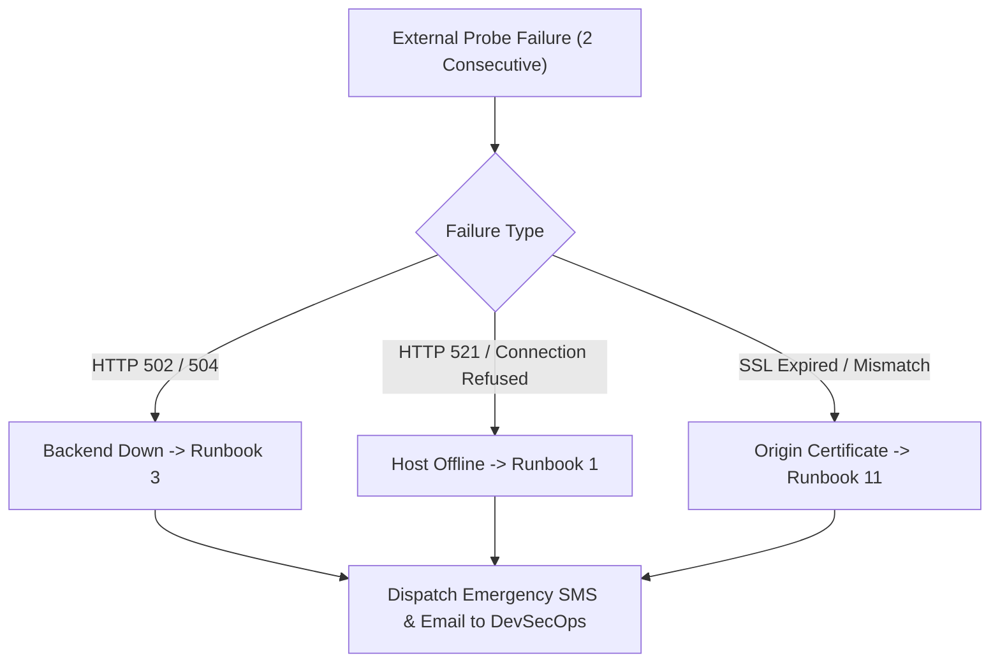

# MECT PHASE 20.4 — EXTERNAL PRODUCTION UPTIME MONITORING PLAN

**Project:** MAHAVEER EDUCATIONAL & CHARITABLE TRUST (MECT)  
**Production Endpoints:** `https://mect.org.in/` & `https://mect.org.in/api/v1/health`  
**Design Lead:** Principal Site Reliability Engineer  
**Status:** SPECIFICATION READY FOR ACCOUNT ONBOARDING  

---

## 1. Monitoring Strategy & Target Endpoints

To ensure zero-downtime operations and immediate incident alerting without relying on internal server metrics, external synthetic probes are specified across two distinct tiers:

### 1.1 Web Tier Monitor (Edge & CDN)
- **Target URL:** `https://mect.org.in/`
- **Probe Interval:** 60 seconds.
- **Probe Locations:** Global (India - Mumbai, Singapore, EU - Frankfurt, US - East).
- **Validation Rules:**
  - Expected HTTP Code: `200 OK`
  - Expected Document Title / Keyword: `Mahaveer Educational & Charitable Trust`
  - Maximum Response Time: < 1,500 ms
  - SSL Certificate Expiry Alert: Trigger warning at ≤ 30 days before expiration.

### 1.2 Application & Database API Tier Monitor
- **Target URL:** `https://mect.org.in/api/v1/health`
- **Probe Interval:** 60 seconds.
- **Validation Rules:**
  - Expected HTTP Code: `200 OK`
  - Expected JSON Keyword: `"status":"UP"`
  - Alert Threshold: 2 consecutive failures across any probe location.

### Security Boundary:
- Internal Actuator details (`show-details: when_authorized`) remain masked from the public. Only high-level health `"status":"UP"` is queried.

---

## 2. Recommended Monitoring Providers

| Provider | Free Tier Capability | SSL Monitoring | Global Nodes | Webhook / SMS Alerting | Recommendation |
|---|---|---|---|---|---|
| **BetterStack (Better Uptime)** | 10 monitors, 3-min checks | Yes | 15+ Global | Email, Webhooks, Push, SMS | **Primary Recommendation** |
| **UptimeRobot** | 50 monitors, 5-min checks | Yes | Global | Email, Webhook, Telegram | High-availability Secondary |
| **Cloudflare Health Checks** | Native on Cloudflare Dashboard | Yes | Cloudflare Edge | Email, Webhooks | Native Alternative |

---

## 3. Incident Escalation Matrix

- **Level 1 (T+2m):** Automated notification dispatch to DevSecOps engineers via push / email.
- **Level 2 (T+10m):** Escalation to Lead Infrastructure Engineer if unresolved.
- **Level 3 (T+30m):** Escalation to Trust Executive Secretariat for public status announcement.
