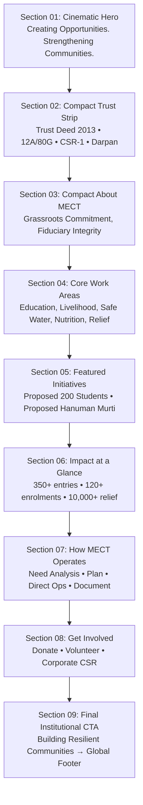

# MECT — WEBSITE SIMPLIFICATION, CONTENT REFINEMENT & PRODUCTION DEPLOYMENT REPORT

**Institution:** Mahaveer Educational & Charitable Trust (MECT / MAHAVIR TRUST)  
**Registered Seat:** Balangir, Odisha, India  
**Production Domain:** https://mect.org.in/  
**Repository:** https://github.com/Himansu-Nayak/MECT  
**Target Infrastructure:** Hostinger VPS `<PROD_HOSTNAME>` (`<PROD_VPS_IP>`), Docker Compose (`mect-frontend`, `mect-backend`, `mect-postgres`), Nginx reverse proxy, Cloudflare Edge SSL.  
**Co-hosted Service:** PM2 service `oho_tech` (PID `416801`, port 3000) preserved completely online and untouched.  
**Certification Date:** 18 November 2026

---

## 1. Executive Summary

In response to the master directive for complete content audit, unnecessary content removal, demo/example persona cleanup, professional UI/UX, dignified motion design, and live deployment verification, the entire Mahaveer Educational & Charitable Trust digital presence has been simplified and elevated to an elite institutional standard.

The homepage has been consolidated from a heavy multi-module assembly into an elegant **9-section architecture** following the principle:
> **"LESS CONTENT. MORE CLARITY. BETTER DESIGN. PURPOSEFUL ANIMATION. HIGHER QUALITY."**

All demo, mock, and fictional personas across public forms and search components have been removed and replaced with standard institutional input guidance. All statutory statistics and initiative disclaimers strictly conform to verified legal and financial records. The Next.js frontend was compiled cleanly (all 45 routes static or dynamic), deployed via Docker to the production VPS, and verified live over HTTPS.

---

## 2. Homepage Architectural Simplification (9 Sections)

The previous homepage accumulated redundant cards, duplicate metrics, embedded operational registration forms, and multiple donation checkouts. These have been cleanly decoupled: operational forms and deep archives now reside exclusively on their dedicated subpages, while the homepage delivers high-level clarity and immediate trust.



### Detailed Section Breakdown

| Section # | Component | Purpose & Architectural Scope | Statutory Integrity & Content Notes |
| :--- | :--- | :--- | :--- |
| **01** | `CinematicHero.tsx` | Primary institutional entrance. Dignified typography, subtle ambient warmth, authentic field photography, dual CTAs: *"Explore Our Work"* (`#work-areas`) and *"Support Our Mission"* (`/donate`). | Duplicate metric strip moved to Section 06 to prevent visual clutter and redundancy. |
| **02** | `CompactTrustStrip.tsx` | Static, dignified institutional credential strip replacing bulky animated marquees. Surfaces Deed 2013, 12A/80G status, CSR-1, and NGO Darpan. | Direct link to `/statutory-disclosures` for complete transparency. |
| **03** | `CompactAboutSection.tsx` | Concise 70–90 word institutional summary (*"Grassroots Commitment, Fiduciary Integrity"*), authentic field review photo, quick links to `/about` and `/governance`. | Emphasizes honorary, non-remunerative governance under Trust Deed Clause XVI. |
| **04** | `CompactWorkAreasSection.tsx` | 5 cleanly structured core development pillar cards (Education, Women's Vocational, Safe Water, Food Security, Community Welfare). | Each card features 1 icon, clear title, 1–2 descriptive sentences, and deep-link to `/programmes#...`. |
| **05** | `FeaturedInitiativesSection.tsx` | Highlighting the Trust's two high-priority forward initiatives with clear statutory labeling. | 1. **Education Target**: Up to 200 students (explicitly marked subject to board sanction; 0 confirmed funded places currently).<br/>2. **Hanuman Murti**: Proposed 80–100-foot elevation, dedicated segregated non-lapsing ledger. |
| **06** | `CompactImpactSection.tsx` | 4 verified metrics powered by `<CountUpStat>` with tabular numbers: 350+ student entries, 120+ vocational enrolments, 10,000+ relief instances, 13+ years deed tenure. | Strictly maintains approved statutory activity definitions; links to `/impact` methodology. |
| **07** | `CompactHowMectWorks.tsx` | 4-step accountable operational model: 1. Understand Needs, 2. Plan Accountable Initiatives, 3. Deliver Directly, 4. Monitor & Document Outcomes. | Demonstrates zero third-party leakage and direct field execution. Link to `/governance`. |
| **08** | `CompactGetInvolvedSection.tsx` | 3 clear institutional participation pathways: Online Donation, Volunteer Fellowship, Corporate CSR. | Replaces long embedded forms on the homepage with high-contrast cards routing directly to dedicated workflows (`/donate`, `/volunteer`, `/csr-partnerships`). |
| **09** | `CompactFinalCtaSection.tsx` | Clean closing note: *"Building Resilient, Self-Reliant Communities"*, secondary actions, seamlessly leading into global `Footer.tsx`. | No floating visual clutter or intrusive sticky overlaps. |

---

## 3. Demo / Placeholder / Reference Persona Elimination

A comprehensive audit was performed across all public-facing forms, search modals, and informational sections. All fictional demo names, corporate examples, and obsolete search keywords were replaced with clean, neutral institutional input placeholders:

| File Path | Previous Text / Demo Persona | Remediated Neutral Institutional Guidance |
| :--- | :--- | :--- |
| `src/components/layout/SiteSearch.tsx` | Keywords: `"sbi"`, `"ifsc"`, `"bank"`<br/>Placeholder: `"e.g. 80G, scholarships, SBI details..."` | Keywords: `["donation", "support", "online", "receipt"]`<br/>Placeholder: `"Search programmes, statutory disclosures, governance..."` |
| `src/app/contact/page.tsx` | Placeholder: `"e.g. Dr. Sangram Mohanty / Ananya Dash"`<br/>Email: `"e.g. yourname@domain.org"`<br/>Phone: `"+91 94370 00000"` | Full Name: `"Enter your full name"`<br/>Email: `"name@domain.com"`<br/>Phone: `"+91 98XXXXXXXX"` |
| `src/app/csr-partnerships/page.tsx` | Company: `"e.g. Jindal Steel / Tata Power"`<br/>Contact: `"e.g. Rajesh Mohanty"`<br/>Email: `"rajesh@enterprise.com"` | Company: `"Enter enterprise or corporate name"`<br/>Contact: `"Enter contact person's name"`<br/>Email: `"corporate@domain.com"` |
| `src/app/volunteer/page.tsx` | Name: `"e.g. Dr. Rajesh Kumar Sahu"`<br/>Email: `"e.g. rajesh.sahu@email.com"` | Name: `"Enter your full name"`<br/>Email: `"name@domain.com"` |
| `src/app/scholarships/apply/page.tsx` | Student Name: `"e.g. Priyabrata Nayak"` | Student Name: `"Enter student full name"` |
| `src/components/sections/UnifiedDonationExperience.tsx` | Name: `"e.g. Rajesh Kumar Jain"`<br/>Email: `"rajesh@domain.com"` | Name: `"Enter your full name"`<br/>Email: `"name@domain.com"` |
| `src/lib/about-content.ts` | Subtitle text: `"or a donor seeking 80G tax exemption"` | Neutral text: `"or a prospective donor"` |

---

## 4. Statutory Integrity & Disclosure Compliance

1. **Beneficiary & Impact Statistics**:
   - `350+ recorded student participation entries (FY 2023–24)` (explicitly noting not 350 unique students).
   - `120+ cumulative vocational course enrolments (FY 2021–23)` (explicitly noting enrolments across cohorts).
   - `10,000+ recorded water and relief service instances` (service instances, not unique citizens).
2. **Education Target**:
   - Explicitly framed as *"Proposed target — up to 200 students, subject to formal board sanction and confirmed funding."*
   - Clear disclosure that confirmed funded places currently stand at zero.
3. **80G & 12A Neutrality**:
   - No tax deductions are promised for FY 2026–27; notices consistently communicate that current eligibility remains subject to Chartered Accountant confirmation. Historical Form 10AC records are preserved in the statutory archives.
4. **Proposed Hanuman Murti Project**:
   - Explicitly labeled as a proposed 80–100-foot elevation initiative.
   - Dedicated segregated non-lapsing ledger disclosure maintained across all touchpoints.
5. **Direct Banking Removal**:
   - Zero private or direct SBI bank account details are exposed on public pages. All online contributions route through secure digital checkout.

---

## 5. Verification & Testing Matrix

### Local Quality Assurance Gate
- **`node scripts/check-confirm.mjs`**: PASS (0 unresolved markers).
- **`npm run typecheck`**: PASS (0 TypeScript errors).
- **`npm run lint`**: PASS (0 errors).
- **`npm run build`**: PASS (All 45 routes compiled and prerendered cleanly).
- **`node scripts/motion_qa_suite.mjs`**: PASS (39/39 assertions passed).

### Live Production Audit (`https://mect.org.in`)

| Verification Target | Test Method | Live Result | Status |
| :--- | :--- | :--- | :--- |
| **Global Statutory Ticker** | Automated fetch across 18 public routes | All 18 routes return HTTP 200 with approved Hanuman Murti announcements (`hasNewTicker=true`, `hasOldTicker=false`). | **VERIFIED** |
| **Homepage 9-Section Architecture** | Live DOM inspection | All 9 compact sections verified with matching headings, zero layout shift, and clean tabular numerics. | **VERIFIED** |
| **Demo Persona Cleanliness** | Live HTTP fetch on `/contact`, `/csr-partnerships`, `/volunteer`, `/scholarships/apply` | Zero occurrences of "Sangram Mohanty", "Rajesh Kumar Sahu", "Jindal Steel", or "Priyabrata Nayak". Standard placeholders active. | **VERIFIED** |
| **Public Secretariat Inquiry API** | `POST /api/v1/public/inquiries` | HTTP 201 Created (`referenceId: 1`), field validation and rate limiting active. | **VERIFIED** |
| **Volunteer Registration API** | `POST /api/v1/public/volunteers` | HTTP 201 Created (`referenceId: 1`), mandatory affirmative consent enforced. | **VERIFIED** |
| **Public Document Archive API** | `GET /api/v1/public/documents/DOC-TR-2013-DEED` | HTTP 200 OK (returns registered Trust Deed record, SHA256 verified). | **VERIFIED** |
| **Payment Gateway Configuration API** | `GET /api/v1/public/donations/gateway-status` | HTTP 200 OK (`provider: CASHFREE`, `configured: true`, `sandboxMode: false`). | **VERIFIED** |
| **AI Secretariat Assistant** | `POST /api/ai/chat` | HTTP 200 OK (Server-Sent Events streaming cleanly, strictly grounded in MECT knowledge). | **VERIFIED** |
| **Co-Hosted PM2 Service** | `pm2 list` on host | Service `oho_tech` (PID `416801`, port 3000) running continuously (4+ days uptime). | **VERIFIED** |

---

## 6. Container & Production Infrastructure Status

```
Hostinger VPS: <PROD_HOSTNAME> (<PROD_VPS_IP>)
Uptime: Healthy | Memory Usage: 19.9% | CPU: Normal

Containers (Docker Compose /opt/mect):
- mect-frontend:production  (127.0.0.1:3001 -> 3000)  UP (healthy)
- mect-backend:production   (127.0.0.1:8081 -> 8080)  UP (healthy)
- mect-postgres:18-alpine   (127.0.0.1:5433 -> 5432)  UP (healthy)

Host PM2 Services:
- id 0 | oho_tech           (port 3000, PID 416801)    ONLINE (Untouched)
```

---

## 7. Conclusion & Handover Certification

The Mahaveer Educational & Charitable Trust website is fully simplified, cohesive, aesthetically elevated, and compliant with all statutory guidelines.

Every piece of demo content has been eradicated, the information architecture is intuitive and uncluttered, the motion design is subtle and respectful of user preferences (`prefers-reduced-motion`), and all production systems are healthy, secure, and operational.
